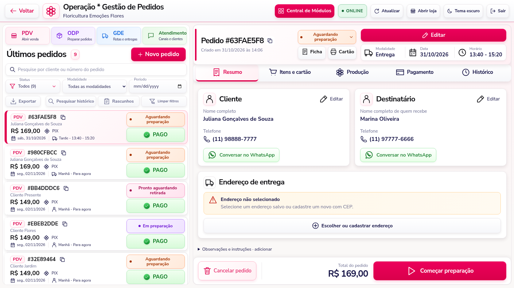

# Acabamento premium e operação — 3.13

## Nova referência visual

A Central de Módulos e os módulos administrativos usam superfícies elevadas, sombras suaves, bordas claras, cabeçalhos com identificação da área e ações principais em rosa. O tema escuro mantém a mesma organização e cores próprias dos status. Os atalhos da operação passam a mostrar **PDV, ODP, GDE e Atendimento**, com a nomenclatura Oficina de Pedidos no painel.

Na Gestão de Pedidos, a coluna de pedidos ocupa aproximadamente 37% da largura em telas amplas. A ficha ocupa a área maior à direita. Em telas menores, o conteúdo se reorganiza para manter os controles acessíveis.



## Lista e pagamento

Cada cartão da lista reúne:

1. Origem da venda, código e botão para copiar.
2. Nome do cliente.
3. Valor e forma de pagamento.
4. Data, modalidade e período/horário.

À direita aparecem **o status do pedido** e **a situação do recebimento**, separadamente:

- **PAGO**, em verde: valor integral registrado.
- **PENDENTE**, em vermelho: nenhum recebimento registrado.
- **PARCIAL**, em amarelo: parte recebida, com indicação do saldo.

Um cancelamento não apaga recebimentos registrados. Se um pedido cancelado já tinha pagamento, o indicador continua mostrando o recebimento; a ficha mantém o aviso de estorno a conferir.

Os botões de copiar funcionam na lista e no cabeçalho. Copiar o código de outro cartão não troca o pedido selecionado. A seleção por teclado usa um botão próprio, sem botões interativos aninhados.

## Ficha do pedido

O cabeçalho tem código, criação, status, Ficha, Cartão e uma área própria para editar o agendamento. Modalidade, data e horário ficam agrupados. A modalidade permanece a definida na venda; o botão **Editar** altera data, período e horário com as validações já existentes da loja.

As abas têm ícones e marcação inferior da seleção. No Resumo, **Cliente** e **Destinatário** ficam em cartões separados, cada um com seus dados, edição e botão **Conversar no WhatsApp**. O contato usa o telefone daquele cartão, com DDD/DDI corretos. Quando não há telefone válido, o atalho fica indisponível até que o contato seja informado.

**Editar cliente** abre a busca do cadastro, com opção de novo cliente e seleção de endereço quando necessária. **Editar destinatário** permite corrigir nome e telefone juntos, na própria ficha. Os lápis de correção pontual continuam disponíveis ao passar o mouse ou usar o teclado.

O rodapé mantém **Cancelar pedido**, **Total do pedido** e a **próxima ação válida** visíveis. Pedidos pendentes/parciais oferecem o recebimento; pedidos pagos seguem as conferências de preparação, retirada ou entrega. Pedidos encerrados mostram o total e o histórico preservado.

## Endereço e pedidos antigos

A área de endereço permite escolher um destino salvo ou cadastrar um novo com CEP. Um endereço completo de pedido antigo continua visível mesmo sem o snapshot do cadastro: a atualização não substitui esse endereço por um aviso vazio.

Se faltar endereço ou cidade, a ficha mostra um aviso e o acesso à seleção/cadastro. O sistema permite preparar o presente após o recebimento e **exige destino completo antes do despacho**. Essa exigência é validada também pelo servidor, inclusive quando o despacho vem de uma rota.

Correções pontuais de nome ou telefone podem ser feitas mesmo se um pedido antigo tiver endereço incompleto. Os dados não relacionados à correção permanecem preservados. A verificação de destino continua sendo exigida no despacho.

Abrir e salvar o agendamento de um pedido antigo “para agora” sem mudar seus dados preserva a data e o período originais. Para reagendar, escolha explicitamente o novo agendamento.

Observações existentes continuam disponíveis. Quando não há observações, a área fica compacta e pode ser expandida para adicionar instruções.

## Histórico e validações

As edições usam a versão do pedido e a identidade da sessão. O histórico registra os campos antes/depois, usuário, data e horário, nas tabelas de auditoria já existentes. Alterações concorrentes são recusadas, com o texto digitado preservado para revisão. Durante a gravação, os campos e ações envolvidos ficam bloqueados até a resposta.

Conferências de cartão/arranjo são reiniciadas quando necessário. Pagamentos parciais não liberam a produção; a conferência continua exigida antes de marcar como pronto. Os recebimentos, valores e itens seguem seus fluxos próprios.

## Atualização

Quem já usa a **3.12**, com o histórico da **3.11** instalado, **não precisa executar outro script SQL**.

1. Pare o servidor com **Ctrl + C**.
2. Atualize os arquivos, preservando `.env`, banco, mídias e sessões.
3. No Prompt, dentro da pasta do projeto, execute:

```cmd
npm ci
npm start
```

4. No navegador, pressione **Ctrl + F5**.

Para instalações anteriores à 3.11, siga também [o guia das tabelas de auditoria](EDICAO-E-HISTORICO-3.11.md). Não recrie o banco.

## Verificação

A suíte automatizada passou com **160 testes e nenhuma falha**, incluindo indicadores de pagamento, edição conjunta do destinatário, versão concorrente, identidade do operador, preservação de endereço antigo e bloqueio de despacho sem destino. A auditoria das dependências de produção apontou **zero vulnerabilidades conhecidas**. A verificação no navegador cobre cópia sem troca de seleção, teclado, WhatsApp por contato, edição com conflito, preservação de agendamento antigo, conferências, endereço e despacho, em oito resoluções e dois temas. Os 21 módulos foram abertos e retornaram à central sem erros de JavaScript. A atualização foi verificada em demonstração e com testes de domínio/HTTP; não foi feita migração ou medição de desempenho no SQL Server da instalação.
