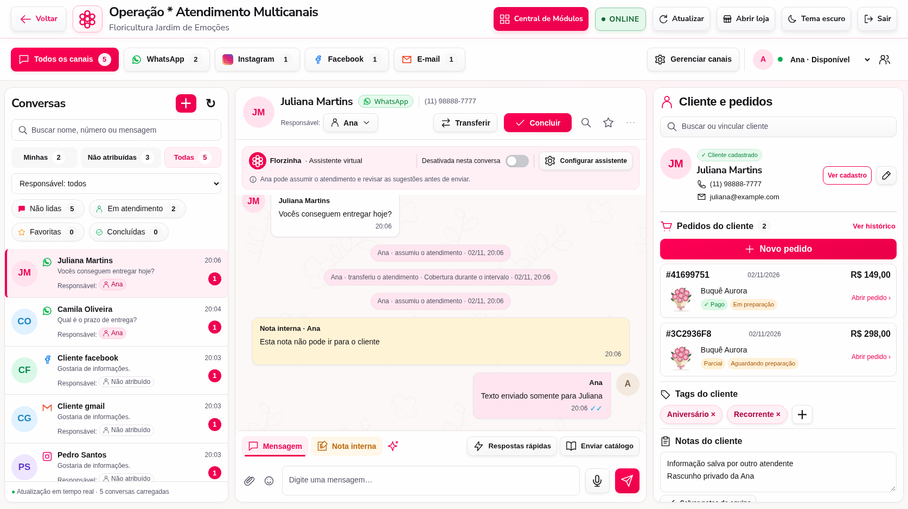
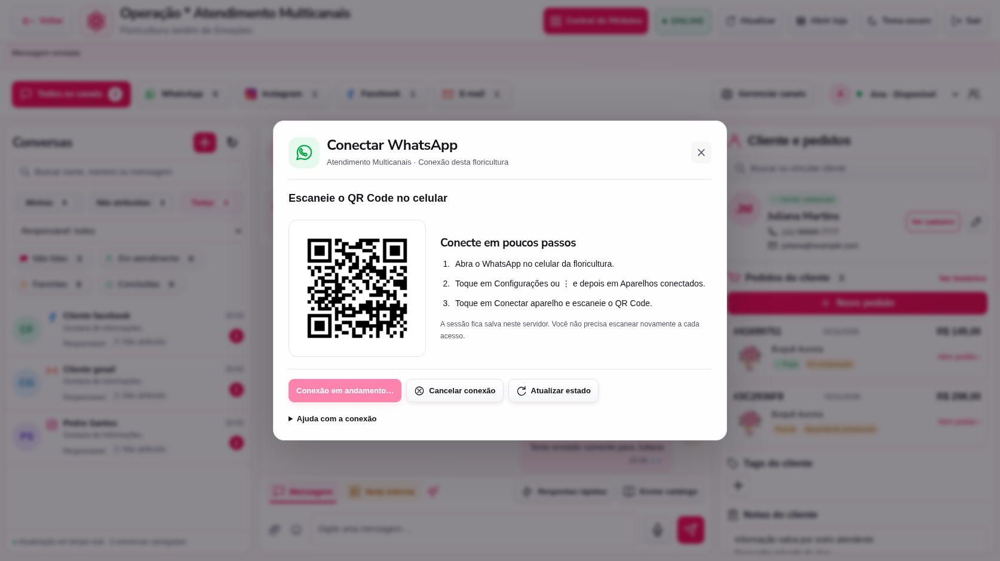
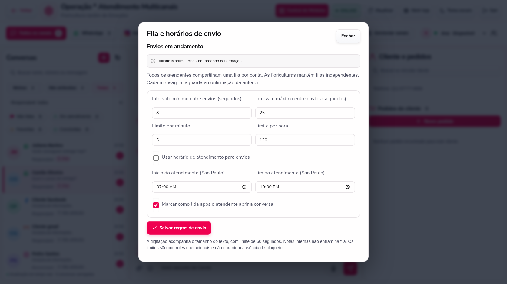

# Atendimento Multicanais e fila compartilhada — 3.16.2

Esta versão refaz a apresentação do Atendimento a partir da referência reenviada, recupera a janela de conexão do WhatsApp e acrescenta os controles de envio solicitados durante a revisão.

## Tela de atendimento

A tela usa a composição da referência: três colunas, superfícies claras, rosa nas ações, textos escuros, filtros com contagens, identidade colorida dos canais, cabeçalho de contato em duas linhas, faixa da assistente, avatares nas mensagens, fundo botânico discreto e controles de envio na parte inferior. Cadastro, pedidos, histórico, tags, notas, transferência e disponibilidade continuam integrados aos dados da floricultura.

As proporções foram verificadas em 1674 × 940, com adaptação para 1024, 768 e 390 pixels e para o tema escuro. Nomes, fotos, produtos e contagens seguem os cadastros e as contas conectadas. As capturas deste guia usam uma loja de teste.



**Enter envia. Shift + Enter quebra a linha.** O editor respeita também a composição de caracteres do teclado. O envio pelo teclado obedece à mesma fila do botão de enviar.

## WhatsApp: conexão e recuperação

Abra **Gerenciar canais → WhatsApp**, ou o botão Conectar WhatsApp do painel vazio.

- A janela mostra o QR Code e as instruções para Aparelhos conectados.
- Os estados aparecem em português, incluindo o diagnóstico que antes ficava escondido atrás de “syncing”.
- Conectar fica desabilitado enquanto já existe uma conexão em andamento.
- **Recuperar sessão** encerra o navegador da integração e reabre a conexão usando o perfil salvo, sem solicitar logout do aparelho.
- **Desconectar aparelho** remove o vínculo e permite uma nova leitura de QR Code.
- Se o navegador anterior não conseguir encerrar, o sistema informa o erro e impede abrir uma segunda instância sobre o mesmo perfil.
- A janela acompanha eventos e também consulta o estado periodicamente. As consultas à integração possuem prazo para retornar.



## Uma fila para todos os atendentes da conta

Se Ana responde à Juliana e Bruno responde ao Pedro ao mesmo tempo, o servidor aceita as duas solicitações e transmite uma por vez. A segunda aguarda a conclusão e a cadência da primeira. Contas de floriculturas diferentes possuem filas independentes.

O navegador recebe um identificador do envio e acompanha a confirmação, sem manter uma requisição aberta por todo o tempo de espera. O texto fica preservado enquanto aguarda. É possível navegar para outra conversa sem trocar o destinatário do envio pendente. Ao voltar à conversa depois da confirmação, o editor é limpo sem apagar outro rascunho.

Cada envio é registrado por operação, conversa, floricultura e atendente. Uma operação já confirmada não transmite novamente. Uma falha depois de chamar o provedor fica em conferência e não recebe repetição automática. Se o sistema comprovar que nada foi transmitido, o texto pode ser tentado novamente. A posse da conversa permanece protegida enquanto a mensagem aguarda; sessão e permissão do atendente são verificadas novamente antes da transmissão.

A fila possui até 50 operações em andamento por conta. Notas internas não entram nessa fila. Anexos e avisos de rotas pelo WhatsApp usam a mesma cadência da conta; o aviso transacional do entregador mantém seu link privado.

Abra **Gerenciar canais → Fila e horários de envio** para acompanhar cliente e atendente dos envios em andamento. O responsável da floricultura também altera as regras nessa janela.



## Cadência, leitura e horários

| Controle | Comportamento inicial |
| --- | --- |
| Intervalo entre envios | Sorteado entre 8 e 25 segundos; o tempo de preparação também pode aumentar a espera. |
| Digitação | Tempo calculado pelo tamanho do texto, entre 200 e 350 ms por caractere, com pausas para frases; mínimo de 1 e máximo de 60 segundos. A presença é renovada durante a preparação quando o WhatsApp permite. |
| Presença | No WhatsApp, acompanha a preparação do envio e retorna a indisponível ao concluir. A sessão vinculada é preservada. |
| Leitura | Após o atendente responsável abrir a conversa e mantê-la visível por 2 a 5 segundos. Pode ser desativada. Não ocorre automaticamente na chegada da mensagem. |
| Limite por minuto | Até 6 para a conta inteira. O excesso aguarda a próxima janela. |
| Limite por hora | Até 120 para a conta inteira. Ao atingir o limite, o texto fica preservado e o operador é informado de que não houve transmissão. |
| Horários | Configuráveis no horário de São Paulo, inclusive turnos que passam da meia-noite. A restrição vem desativada; ao ativar, os valores iniciais são 07:00–22:00. Mensagens fora da janela não são transmitidas. |
| Aviso de limitação do provedor | Pausa de pelo menos 5 minutos, respeitando um Retry-After maior quando informado. Não há repetição automática do envio que ficou incerto. |
| Primeiro contato com link | O Atendimento pede uma apresentação sem links e uma resposta do cliente antes de enviar URLs. |
| Respostas rápidas | Opções de boas-vindas, consulta de prazo e encerramento para o atendente escolher e personalizar. O texto aprovado não é reescrito durante a transmissão. |

Esses limites são controles operacionais, não limites oficiais nem garantia de ausência de bloqueio. Para operação comercial em escala, a integração oficial do WhatsApp Business é a opção apropriada. A versão mantém a conexão Web existente; não adiciona falsificação de impressão digital, movimentos artificiais de mouse, erros propositais, participação automática em grupos ou tráfego fabricado entre números próprios.

O despacho e os contadores funcionam na instância do servidor que mantém a sessão da conta. Os registros de operação ficam no SQL Server em produção. Uma reinicialização não repete automaticamente trabalhos cuja transmissão ficou incerta. Em uma futura instalação com vários processos ou servidores atendendo a mesma conta, o despachante precisa ser compartilhado antes de habilitar esse cenário.

## Atualizar no Windows

1. Encerre o servidor atual com **Ctrl + C**.
2. Faça backup do projeto e do banco.
3. Substitua os arquivos do aplicativo. Preserve `.env`, banco, `.tenants`, `.wwebjs_auth`, sessões, mídias, `.order-uploads` e `.driver-access`.
4. No diretório do projeto, execute:

```cmd
npm ci
npm start
```

5. Abra o painel e pressione **Ctrl + F5**.
6. Em Gerenciar canais, confira o WhatsApp. Se estiver preso em sincronização, use Recuperar sessão.
7. Confira os intervalos, limites e horários em Fila e horários de envio.

Da 3.16 ou 3.16.1 para esta versão, não há nova tabela nem migração adicional. Se vier de versão anterior, siga primeiro a instalação do esquema descrita em [3.16](OPERACAO-MULTICANAL-E-ENTREGAS-3.16.md).

## Verificação

```cmd
npm test
npm run verify:references
```

Os testes cobrem concorrência entre atendentes, filas independentes, cadência com relógio controlado, digitação, limites, cancelamento por desconexão, horário de São Paulo, primeiro contato, idempotência e recuperação da sessão. A verificação de navegador usa canais simulados, testa Enter/Shift + Enter, destinatários, rascunhos, notas concorrentes, QR Code e a composição visual em quatro larguras.

Nenhuma mensagem foi enviada a contas reais nesta verificação. A conexão com o aparelho do cliente, SQL Server e canais externos precisa ser conferida na instalação atualizada.
