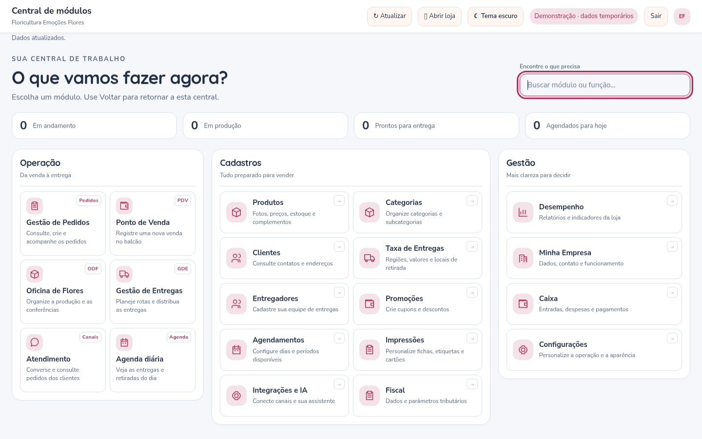
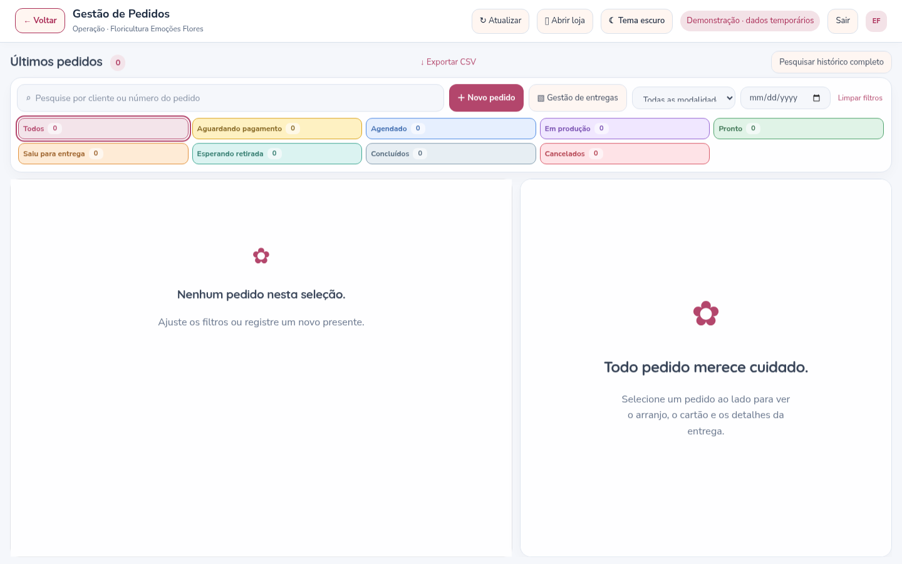

# Central de módulos e mídias — versão 3.5

## Uma central para cada floricultura

O painel da floricultura começa em uma central que ocupa toda a largura da tela. Os vinte módulos estão organizados em **Operação**, **Cadastros** e **Gestão**, com nomes, descrições e ícones. A busca reconhece termos como “cupom”, “novo pedido” e “nota”. O resumo da central considera os pedidos carregados no painel (no SQL Server, até 200 pedidos recentes), não todo o histórico.

Ao escolher um módulo, a área de trabalho ocupa a tela e o botão **← Voltar** retorna à central. O PDV mantém seu fluxo de venda e os formulários de cadastro continuam em janelas próprias. Atendimento e Gestão de Pedidos aproveitam a altura restante para as suas listas, detalhes e mensagens. Listas extensas e celulares continuam usando rolagem quando necessária para preservar a leitura.

Os módulos seguem a mesma moldura, tema, cores configuradas pela loja, tipografia e estilo de painéis. A página da Inova e o site público continuam com seus acessos separados. A navegação lateral permanente do painel da loja foi substituída pela central; a opção antiga de recolher a lateral foi retirada do formulário de aparência.

O botão Voltar, o histórico do navegador e o atalho **Alt+Home** facilitam o retorno. O endereço identifica o módulo, por exemplo `/painel/emocoes-flores#catalog`, e pode ser salvo como favorito. Uma janela de edição ou venda aberta impede que a mudança pelo histórico descarte o trabalho silenciosamente.





## Correção das fotos que não apareciam

A pasta de mídia usa o nome `.product-media`. A rota anterior podia bloquear sua leitura por começar com ponto. A rota agora atende somente o arquivo de mídia permitido, dentro da pasta da floricultura correspondente. O teste automatizado usa uma pasta oculta como a instalação real, baixa o arquivo e o decodifica para conferir o conteúdo.

O navegador também recebe uma nova versão da URL de exibição, evitando reaproveitar uma resposta antiga em cache. Fotos válidas já enviadas passam a ser exibidas sem precisar cadastrá-las novamente. Arquivos antigos que estavam corrompidos devem ser reenviados a partir de uma cópia válida.

## Imagens e vídeos

O envio faz **conversão de verdade**, em vez de apenas aceitar extensões que o navegador não consegue exibir:

| Envio | Preparação para exibição |
| --- | --- |
| JPEG/JPG/JFIF, PNG, WebP, GIF, AVIF, TIFF e SVG | Decodificação e conversão para WebP |
| HEIC/HEIF, inclusive fotos de celular com HEVC | Decodificação com libheif e conversão para WebP |
| BMP, ICO e outros formatos de imagem reconhecidos pelo conversor | Conversão para WebP |
| MOV, AVI, MKV, MP4, WebM, WMV, MPEG, M4V, FLV, 3GP, MTS e outros contêineres reconhecidos | Conversão para MP4 com vídeo H.264 e áudio AAC, quando houver áudio |

As imagens têm até **25 MB por envio**, limite de resolução de entrada e são ajustadas para até 2.000 pixels, sem ampliar as fotos já adequadas. Até três imagens por produto; a primeira é a capa. Vídeos têm até **100 MB por envio e 10 minutos**, com resolução final limitada a Full HD. A conversão usa limites de tempo e recursos; arquivos muito pesados podem precisar de uma versão menor. A biblioteca continua com limite de 500 MB por floricultura.

“Todos os formatos” não pode ser garantido literalmente: arquivos corrompidos, protegidos, formatos proprietários, codecs desconhecidos ou tipos não reconhecidos podem não ser convertidos. O sistema informa o problema e não salva uma extensão falsa. Os links externos continuam aceitando YouTube, Vimeo e arquivos HTTPS MP4/WebM; o sistema não baixa nem converte URLs externas.

Os originais não são mantidos como cópia de segurança. Os arquivos de exibição são normalizados para o site e não devem substituir o arquivo original de trabalho da loja. Fotos e vídeos ficam em `.product-media`, separados por floricultura. Preserve essa pasta e inclua-a nos backups.

## Atualizar no Windows

Na pasta do sistema, depois de atualizar o código e preservar `.env` e as pastas privadas, execute:

```bat
npm ci
npm run media:setup
npm start
```

Depois use **Ctrl+F5** no navegador.

**Não altere seu `.env` para esta versão. Não há nova alteração de esquema no banco em relação à 3.4.** A tabela de histórico instalada na 3.4 continua necessária e o servidor mantém sua verificação/criação automática.

`npm run media:setup` instala o FFmpeg correspondente ao sistema operacional. É necessário acesso à internet durante essa instalação. Se o npm já tiver instalado o conversor, o comando apenas confirma sua presença. Essa etapa é explícita porque versões recentes do npm podem bloquear scripts de instalação de dependências. O download e os detalhes de licença são os da distribuição `ffmpeg-static`.

Na nuvem, use disco persistente compartilhado entre instâncias para `.product-media` e as demais pastas de dados. Um FFmpeg disponível no PATH também pode ser utilizado. Não há download de conversor dentro de uma requisição do cliente. A conversão limita o processamento simultâneo a duas tarefas por processo e uma por floricultura; nessa situação, a tela orienta aguardar antes do próximo envio.

## Verificações

Foram exercitados os vinte módulos, o retorno à central, a busca, o histórico, o acesso direto por endereço, dois temas e sete resoluções. A foto AVIF foi enviada, convertida e decodificada no navegador; o MOV foi convertido e teve dimensões de vídeo reconhecidas pelo player, usando uma pasta `.product-media` oculta. Também foram verificados os fluxos existentes de venda, recebimento e agendamento do PDV.

Na publicação da versão 3.5, a auditoria npm corrigiu atualizações compatíveis disponíveis de body-parser e Nodemailer. Naquele momento, permaneceram dois alertas transitivos altos na cadeia `mssql → tedious → @azure/identity → @azure/msal-node`: a versão de identidade dependia da série 6, enquanto a correção do MSAL estava na série 7. **Essa pendência foi corrigida na versão 3.6.1**, com atualização compatível do próprio `@azure/identity`; consulte [o guia da correção](SEGURANCA-3.6.1.md).

Os testes usam dados temporários. O SQL Server do computador do cliente não foi acessado neste ambiente, e os testes de execução do conversor foram realizados em Linux, não em uma máquina Windows real.
