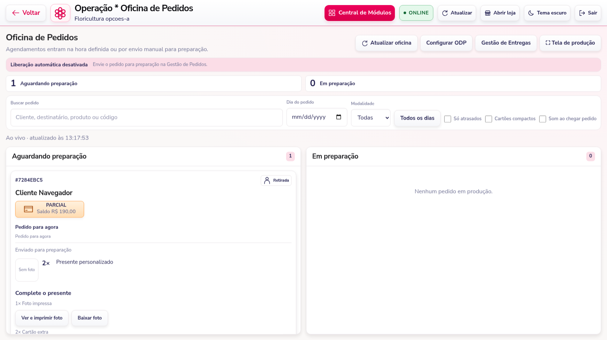
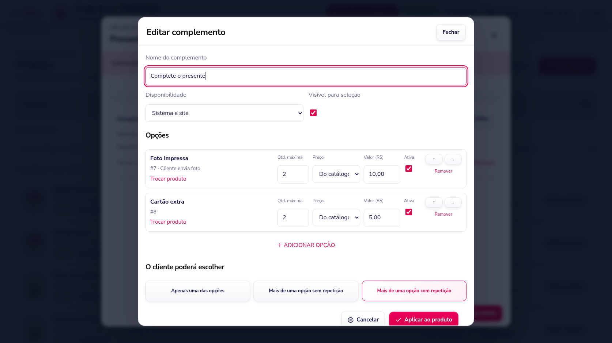

# Complementos, fotos e pagamentos — 3.15

## Oficina e pagamentos parciais

Um recebimento parcial libera o preparo na Oficina de Pedidos. Pedidos agendados respeitam a liberação manual ou a antecedência configurada, como os integralmente pagos. O saldo continua visível e precisa ser quitado antes da entrega ou retirada. Uma quitação posterior preserva a etapa de produção já alcançada.

Cada cartão da Oficina mostra a tag de pagamento: **PAGO**, **PARCIAL em laranja** ou **PENDENTE**, conforme os registros. Pedidos sem recebimento continuam aguardando pagamento.



## Categorias em três níveis

Em Categorias é possível criar **categoria → subcategoria → terceiro nível**. Ao selecionar o terceiro nível no produto, os dois superiores são marcados automaticamente. O servidor também confere essa associação. Ciclos, referências de outra loja e um quarto nível são recusados. A hierarquia aparece no catálogo, no PDV e na loja.

## Complementos por produto

Em **Produtos → Editar → Complementos**, adicione grupos com nome, visibilidade, ordem e opções escolhidas entre produtos cadastrados. Cada opção pode acompanhar o preço do catálogo ou ter preço próprio, inclusive zero. É possível ordenar, desativar e remover opções.



As regras disponíveis são:

- Uma opção; várias sem repetição; várias com repetição.
- Quantidade mínima e máxima do grupo, e máxima por opção.
- Preço pela soma, média ponderada pelas quantidades, maior preço ou menor preço selecionado. Maior/menor cobram o preço de uma opção por unidade do produto principal.

As escolhas valem por unidade do produto principal. Seus valores são conferidos pelo servidor; não são aceitos preços enviados pelo comprador. O estoque considera o produto principal e todas as opções, multiplicados pelas quantidades. As escolhas e preços ficam preservados no pedido, no histórico do produto e na ficha de produção. As antigas sugestões de complementos são importadas para um grupo ao editar e salvar o produto.

## Foto enviada pelo cliente

No cadastro do produto, escolha **Tipo de produto → Mídia · foto para impressão**. Defina se a foto é obrigatória e o máximo de arquivos. Esse produto pode ser vendido sozinho ou como opção de um complemento.

O PDV e a loja permitem enviar JPG, PNG, WebP ou HEIC, até 20 MB e 40 megapixels por foto. O sistema gera PNG para impressão, preserva a resolução e corrige a orientação. Na Oficina e na aba Produtos do pedido aparecem **Ver e imprimir foto** e **Baixar foto**. A impressão usa a janela de impressão do navegador, com escolha da impressora pelo operador.

As fotos não ficam na galeria pública dos produtos. O arquivo só pode ser acessado pela sessão autenticada da loja do pedido. Envios ainda não usados expiram em sete dias; sua limpeza ocorre em envios posteriores. Os metadados ficam nas tabelas indexadas `OrderUploads` e `OrderUploadUsage`, e os arquivos ficam na pasta privada `.order-uploads`, fora do catálogo e do conteúdo público. A cota padrão é 5 GB por loja, ajustável por `ORDER_UPLOAD_QUOTA_MB`; o diretório pode ser definido por `ORDER_UPLOAD_ROOT`.

## Corrigir recebimento lançado errado

Na aba **Pagamento** do pedido, ou na janela de recebimentos, use **Remover lançamento** e informe o motivo. O saldo e a tag são recalculados. O registro original fica marcado como removido, com usuário, data, horário e motivo; ele não é apagado do histórico nem volta a compor o valor recebido. Depois, registre a forma/valor corretos.

Pedidos já encerrados aceitam a reposição de um recebimento corrigido, preservando sua conclusão, seus preços e seu estoque. Essa operação corrige o registro no sistema e não executa devolução bancária.

## Atualização do banco e dos arquivos

1. Pare o servidor com **Ctrl + C** e faça o backup habitual do banco.
2. Atualize os arquivos, preservando `.env`, mídias, sessões e a pasta privada `.order-uploads`, caso já exista.
3. Na pasta do projeto, instale as dependências:

```cmd
npm ci
```

4. **Em SQL Server**, instale as novas tabelas no banco atual:

```cmd
npm run migrate:order-uploads
```

O comando usa a configuração SQL do `.env`, adiciona tabelas e índices e não recria pedidos ou clientes. Se a conta da aplicação não puder criar tabelas, execute [sql/order-uploads.sql](sql/order-uploads.sql) no SSMS com uma conta autorizada. O início do servidor também verifica a instalação. No modo de demonstração, pule esta etapa.

5. Inicie e atualize o navegador:

```cmd
npm start
```

Pressione **Ctrl + F5**. Instalações anteriores à 3.11 devem consultar também [o guia de auditoria de pedidos](EDICAO-E-HISTORICO-3.11.md).

## Verificação

A suíte passou com **174 testes e nenhuma falha**; a auditoria das dependências de produção apontou **zero vulnerabilidades conhecidas**. Os testes cobrem os limites das categorias, preços e estoque dos complementos, pagamentos parciais, correção de recebimentos, histórico, isolamento das lojas, fotos privadas, reenvio de pedido e vínculo das fotos na transação SQL. A conferência no navegador inclui o cadastro, as escolhas e o envio de foto no PDV e na loja, a tag na Oficina, a abertura da foto e a substituição de um recebimento incorreto. O editor foi conferido em cinco larguras, nos temas claro e escuro. Os testes usam demonstração e transações SQL simuladas; o script ainda precisa ser executado no banco da instalação.
