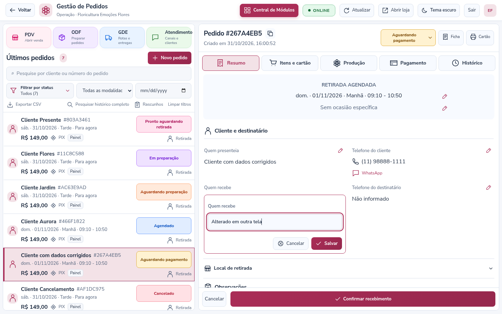

# Edição por linha e histórico — versão 3.11

## Painel

- Todas as etiquetas de status de pedidos têm a mesma largura e altura, incluindo as legendas maiores.
- O cabeçalho tem um botão destacado **Central de Módulos**, disponível também no PDV. Ao usá-lo durante uma venda, o PDV salva o rascunho antes de voltar. Se a gravação falhar, permanece na venda com os dados preservados.
- **Voltar** aparece nos módulos e retorna à origem. A página inicial da Central de Módulos não apresenta esse botão.
- A indicação do mecanismo de banco foi retirada do cabeçalho.
- **ONLINE**, em verde, exige conexão com o servidor e, na operação da loja, o fluxo autenticado de atualizações. A verificação de saúde também consulta o banco no modo SQL Server. **OFFLINE**, em vermelho, indica desconexão, falha de saúde ou interrupção desse fluxo. Falhas de rede do navegador são refletidas imediatamente; a saúde é conferida a cada 15 segundos, com limite de espera de 7 segundos. Este indicador representa o sistema; cada integração mantém seu próprio estado de conexão.

## Lápis ao lado da informação

Na ficha do pedido, clique no lápis ao lado de cliente, telefones, destinatário, agendamento, ocasião, endereço, referência, observações, orientações do arranjo, substituições, mensagem ou assinatura do cartão. O campo abre **na própria linha**, com **Salvar** e **Cancelar**. Não é mais necessário abrir o formulário geral “Editar dados”.

Endereço/bairro/cidade e data/faixa/período são editados em pequenos grupos na própria ficha para manter combinações válidas. O reagendamento continua sujeito aos horários e à capacidade da loja. A modalidade, os itens e os valores originais continuam seguindo os fluxos próprios de venda e recebimento. O diretório de clientes não é modificado por uma correção no pedido.

As restrições de pedidos expedidos e encerrados continuam valendo. Alterar cartão ou arranjo reinicia as conferências correspondentes. Se outra tela alterar o pedido durante a digitação, a gravação é recusada e o texto digitado permanece visível para revisão. Use Cancelar para reler a versão atual antes de editar novamente.



## Quem mudou, o que mudou e quando

A aba **Histórico** consulta o registro completo em páginas de 50 eventos, com acesso aos anteriores. Cada alteração mostra o usuário, a data e o horário de São Paulo. **Ver alterações** apresenta os campos e os valores antes/depois. O servidor obtém a identidade da sessão autenticada; o navegador não escolhe o autor. Também são registrados o identificador do usuário, seu perfil e a versão do pedido. A oficina, as rotas e os recebimentos usam a mesma persistência de auditoria. A automação é identificada como Sistema/ODF.

Os registros antigos mantêm o autor e o horário que já existiam. Um registro antigo com autor genérico não ganha retroativamente uma identidade que não foi registrada na época. No acesso legado por chave administrativa não existe identificação individual; use os acessos pessoais da plataforma para essa identificação.

## Banco e atualização

**Esta versão adiciona duas tabelas. Não recrie o banco.**

1. Pare o servidor, mantenha uma cópia de segurança do banco atual e preserve o `.env`, as mídias e as sessões da instalação.
2. Atualize os arquivos e execute `npm ci`.
3. No SSMS, selecione **o mesmo banco definido em SQL_DATABASE** e execute [sql/order-events.sql](sql/order-events.sql) com uma conta autorizada. O script é repetível e cria somente as estruturas ausentes. A aplicação também tenta criar essas tabelas na inicialização; se não tiver permissão, informa qual script executar.
4. Execute `npm start` e recarregue o navegador.

A aplicação precisa de **SELECT e INSERT** em `dbo.OrderEvents` e `dbo.OrderEventChanges`, além das permissões que já utiliza nas demais tabelas. As rotas não editam nem excluem eventos. Não é necessário conceder privilégios de alteração de esquema à conta de operação quando as tabelas já estiverem instaladas.

`dbo.OrderEvents` mantém o cabeçalho de cada evento: loja, pedido, sequência, usuário, horário UTC e descrição. `dbo.OrderEventChanges` mantém cada campo alterado e seus valores anteriores/novos. As chaves relacionam as mudanças ao evento e o evento ao pedido. Os índices começam pela loja e pelo pedido; há também um índice por usuário/data. A paginação usa a sequência do evento, sem percorrer todas as páginas anteriores por OFFSET. As consultas são autenticadas e sempre limitadas à loja da sessão.

A mudança no pedido e a inclusão do histórico ocorrem **na mesma transação**. Uma falha ao gravar a auditoria desfaz a edição. O JSON do pedido mantém somente um cache dos 20 eventos mais recentes; o histórico completo fica nas tabelas separadas. Assim, a fila e o salvamento não precisam carregar ou regravar um histórico que cresça indefinidamente.

Pedidos antigos continuam legíveis. Seu histórico completo é separado automaticamente na próxima gravação, sem apagar eventos. Para antecipar essa separação em toda a base, há um comando opcional:

```sh
npm run migrate:order-history
```

Execute com a configuração local do banco e com o servidor parado. O comando lê lotes de até 50 pedidos e grava um pedido por transação; pode ser retomado após interrupção. Não altera os valores, a versão funcional ou os clientes, nem apaga pedidos. A migração geral `npm run migrate:platform` também instala as duas novas tabelas.

Esta alteração separa a auditoria. Outros dados já existentes no JSON do pedido, como itens e recebimentos, permanecem no modelo atual. A velocidade em uma base real depende também do volume, dos índices usados pelas demais consultas e dos recursos do servidor; não foi realizado benchmark no banco da instalação.

No modo demonstração, tanto pedidos quanto auditoria ficam em memória e se perdem ao reiniciar.

## Validação

**155 testes automatizados passaram** e a auditoria de dependências encontrou **zero vulnerabilidades conhecidas**. Os testes cobrem edição restrita por campo, identidade da sessão, valores antes/depois, versão concorrente, isolamento entre lojas, paginação sem duplicação durante novas gravações, preservação de histórico antigo e reversão diante de falha na auditoria. Verificação no Chromium cobre lápis e conflitos, ONLINE/OFFLINE, navegação, filtros, rascunhos e etiquetas em sete resoluções e temas claro/escuro. As verificações SQL usam simulação de transações; a execução da migração e o desempenho em SQL Server real precisam ser conferidos na instalação.
