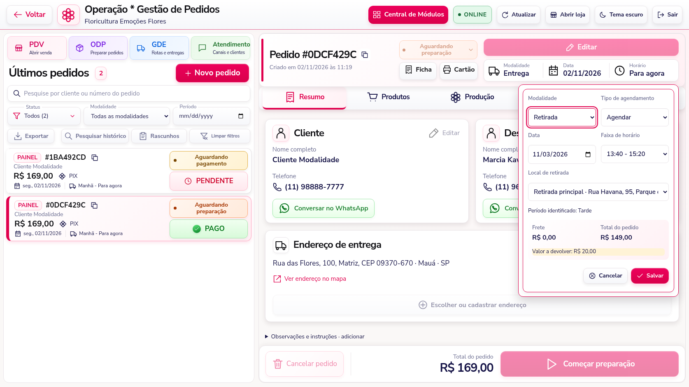

# Modalidade e Atendimento — 3.14

O botão **Editar** no cabeçalho do pedido agora permite escolher **Entrega, Retirada ou Venda Loja**, além de data e faixa de horário. O período é identificado automaticamente pelo início da faixa; não existe mais um seletor de período nesse formulário.



Ao mudar para Entrega, escolha o endereço salvo do cliente ou cadastre um novo. Ao mudar para Retirada, selecione a unidade. Antes de salvar, o formulário apresenta o frete, o novo total e eventual saldo a receber ou valor a devolver. O servidor confere novamente os valores e a disponibilidade do agendamento. Os produtos, descontos concedidos e recebimentos anteriores são preservados.

Se o novo total ultrapassar o recebido, o pedido passa a aguardar a diferença. Se ficar abaixo do recebido, a ficha sinaliza o valor a devolver; a atualização não executa devolução bancária. A modalidade pode mudar enquanto o pedido está em preparação ou aguardando retirada. Pedidos expedidos ou encerrados mantêm seus dados protegidos. Pedidos antigos sem registro do frete original precisam ter seus valores conferidos antes da troca de modalidade.

Os botões **Conversar no WhatsApp** dos cartões Cliente e Destinatário abrem o módulo **Atendimento · Canais e clientes**, no número do cartão. O canal WhatsApp é selecionado automaticamente. Se estiver desconectado, o número permanece indicado na tela e a conversa abre após a reconexão. Abrir uma conversa não envia mensagens.

Na edição do endereço pela ficha, **Salvar e usar no pedido** atualiza o endereço, o nome e o telefone do destinatário na tela principal sem exigir um segundo salvamento. A seleção de um endereço existente também aplica seus dados ao pedido. As cópias de endereço de outros pedidos permanecem preservadas. Quando a seleção faz parte de uma troca de modalidade ou cliente, confira os dados e o total e conclua no botão Salvar do formulário correspondente.

A aba **Itens e cartão** passa a se chamar **Produtos**, mantendo produtos, orientações e cartão do presente disponíveis.

As alterações continuam registrando usuário, data, horário e valores anteriores/novos, com controle de versão para impedir a perda de alterações concorrentes.

## Atualização

Para quem já está na 3.13, **não há novo script SQL**.

1. Pare o servidor com **Ctrl + C**.
2. Atualize os arquivos, preservando `.env`, banco, mídias e sessões.
3. Na pasta do projeto, execute:

```cmd
npm ci
npm start
```

4. No navegador, pressione **Ctrl + F5**.

Instalações anteriores à 3.11 devem consultar também [o guia das tabelas de auditoria](EDICAO-E-HISTORICO-3.11.md), sem recriar o banco.

## Verificação

A suíte automatizada passou com **164 testes e nenhuma falha**. Os testes de domínio e HTTP cobrem o recálculo do frete, recebimentos antigos e parciais, valor a devolver, período automático, identidade do operador, versão concorrente, vínculo do endereço e isolamento entre lojas. A conferência no navegador cobre troca de modalidade nos dois sentidos, atualização imediata do destinatário, acesso aos dois números no Atendimento, preservação de rascunho, desconexão/reconexão e quatro resoluções. A verificação usa demonstração e serviços de canal simulados, sem enviar mensagens reais ou alterar o SQL Server da instalação.
