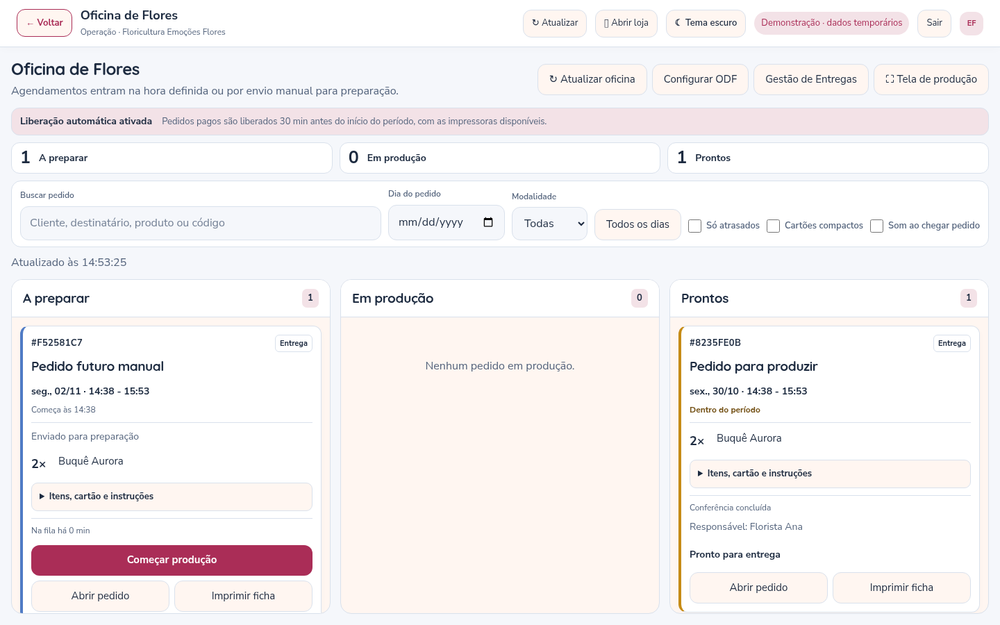
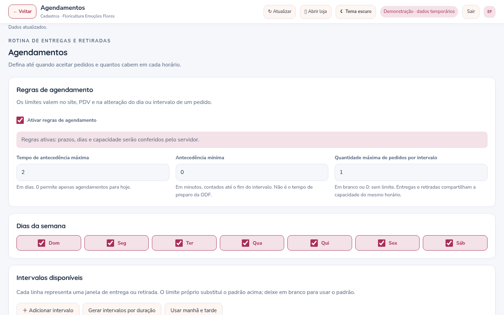

# Oficina de Flores e Agendamentos — versão 3.6

## Atalhos na Gestão de Pedidos

Os quatro atalhos voltaram ao cabeçalho da Gestão de Pedidos: **PDV**, **ODF**, **GDE** e **Atendimento / Canais**. Eles abrem os módulos em tela ampla; o botão **Voltar** continua retornando à central.

## ODF como tela de produção

A Oficina de Flores usa três colunas, como um KDS de cozinha:

1. **A preparar:** pedidos pagos já enviados para preparação, automaticamente ou pela equipe.
2. **Em produção:** pedidos cujo trabalho começou pelo botão **Começar produção**.
3. **Prontos:** pedidos conferidos e liberados para entrega ou retirada.

Pedidos apenas agendados e pedidos sem pagamento confirmado ficam fora da ODF. Na Gestão de Pedidos, **Enviar para preparação · ODF** permite antecipar manualmente um pedido pago, inclusive de uma data futura. Pedidos prontos saem da oficina quando seguem para entrega, retirada concluída ou outra etapa final.

Os cartões mostram quantidades, cliente/destinatário, modalidade, dia e intervalo, nome do período, tempo na fila/produção e alertas de prazo. As instruções do produto, itens que acompanham, cartão e observações podem ser expandidos. **Conferir e concluir** exige a conferência do arranjo, embalagem e cartão, quando houver mensagem. O histórico registra o início da produção e o responsável.

Há busca por cliente/produto/código, filtros de dia, modalidade e atrasos, contadores clicáveis por etapa, cartões compactos, som opcional ao chegar pedido e modo de tela cheia. O som depende da permissão e interação no navegador. A preferência de cartões compactos fica salva por loja no navegador. A lista atualiza por padrão a cada cinco segundos, sem recarregar a página; o intervalo pode ser configurado entre 2 e 120 segundos.

A consulta da ODF é independente dos 200 pedidos recentes do painel: retorna até 500 pedidos liberados, com aviso quando houver mais. A tela adapta as colunas a computadores, tablets e celulares; filas extensas preservam a rolagem para manter a leitura.



## Preparação automática e impressoras

Em **Configurações → Oficina de Flores — ODF**, ative **Iniciar preparação dos pedidos agendados automaticamente** e defina a antecedência em minutos. A opção vem **desativada** na atualização e é individual por floricultura.

O prazo é contado antes do **início** do intervalo, no fuso de São Paulo. Exemplo: entrega entre **10:00 e 12:00**, antecedência de **60 minutos** → liberação a partir de **09:00**. O pedido pago muda de **Agendado/Recebido** para **Em preparação**, aparece em **A preparar** e recebe um registro automático no histórico. A equipe ainda precisa iniciar a produção e conferir o pedido pronto.

O servidor verifica a liberação em ciclos de cinco segundos, mesmo com o painel fechado. Mantenha `npm start` em execução. O ciclo não é uma garantia de tempo real exato: consulta das impressoras, banco e carga do servidor podem acrescentar atraso. Depois de uma interrupção, ele também recupera pedidos pagos que já passaram do prazo e ainda aguardam preparação. Pedidos antigos sem faixa horária exata precisam de encaminhamento manual.

Para respeitar a disponibilidade exigida, a automação requer **ao menos uma impressora cadastrada e todas as impressoras dessa floricultura confirmadas como disponíveis**. Se alguma estiver offline, sem papel ou com estado não confirmado, a liberação automática pausa e o motivo aparece na ODF. Quando a disponibilidade volta, a próxima verificação retoma o trabalho sem liberar novamente pedidos já encaminhados. O envio manual continua disponível.

### Configurar no Windows

1. Instale e teste as impressoras nas configurações de impressão do Windows, no computador que executa o servidor.
2. Nesse computador, entre no painel pelo endereço `http://localhost:3000/painel/<loja>` ou `127.0.0.1` e abra **Cadastros → Impressões**.
3. Em **Impressoras da loja**, use **Cadastrar impressora**, selecione a fila encontrada e dê um nome fácil de reconhecer. Cadastre apenas as filas utilizadas por essa floricultura.
4. Confira a disponibilidade e só então ative a preparação automática em **Configurações → Oficina de Flores — ODF**.

O servidor consulta as filas reais do Windows por PowerShell/Win32_Printer; não há uma chave de configuração nem um botão para simular “online” no painel. Descoberta e cadastro exigem acesso local ao computador do servidor. Outros dispositivos autenticados podem consultar o estado das impressoras já cadastradas e operar a loja normalmente.

A confirmação depende do que o driver informa ao Windows: não substitui a verificação física de papel, conexão e funcionamento. Em Linux ou hospedagem na nuvem, será necessária uma ponte local de impressão, ainda não incluída nesta versão; a liberação automática permanece bloqueada quando não é possível confirmar as filas. O cadastro e a consulta não enviam trabalhos de impressão. A ficha e os modelos continuam sendo impressos por ação do operador, pela janela de impressão do navegador.

## Agendamentos: prazos e capacidade

Em **Cadastros → Agendamentos**, a nova tela organiza as regras em cartões, dias da semana, intervalos e datas bloqueadas. Ative **Ativar regras de agendamento** para aplicar os limites.

| Campo | Comportamento |
| --- | --- |
| **Tempo de antecedência máxima** | Quantos dias à frente aceitar agendamentos, até 365. `0` permite somente hoje. |
| **Antecedência mínima** | Minutos mínimos até o **fim** do intervalo, mantendo a regra anterior. É independente da antecedência da ODF, contada antes do **início**. |
| **Quantidade máxima de pedidos por intervalo** | Capacidade padrão para cada data/faixa. Em branco ou `0`: sem limite. |
| **Máximo de pedidos em uma faixa** | Em branco: herda a capacidade padrão. `0`: faixa sem limite. Outro número: substitui o padrão nessa faixa. |
| **Dias da semana e datas bloqueadas** | Definem dias aceitos e exceções como feriados e folgas. |

Cada faixa permite nome, início, fim, entrega/retirada e capacidade própria. **Gerar intervalos por duração** cria horários consecutivos; **Usar manhã e tarde** oferece um modelo inicial. A substituição de horários pede confirmação. Faixas sobrepostas da mesma modalidade são recusadas. O nome escolhido fica registrado nos novos pedidos e nos reagendamentos, junto ao horário.



Entregas e retiradas compartilham a capacidade da mesma data e faixa. O limite conta **pedidos**, não quantidade de produtos. Pedidos aguardando pagamento ocupam vaga; cancelados liberam vaga. Pedido para agora e venda na loja não usam a capacidade de agendamento. Carrinhos ainda não enviados não reservam vaga.

Site e PDV consultam a disponibilidade e indicam os intervalos lotados. O servidor verifica novamente ao gravar, inclusive em envios simultâneos e alterações de data/faixa: escolher um horário na tela não garante a última vaga. Nesse caso, a pessoa recebe a orientação para selecionar outro. A criação e o reagendamento usam a mesma transação de conferência no SQL Server. Pedidos existentes mantêm seu histórico e valores; mudar as regras não os cancela nem os reagenda automaticamente.

## Atualização da instalação existente

Pare o servidor com **Ctrl+C**, faça seu backup habitual e atualize os arquivos preservando `.env`, banco, `.tenants`, `.product-media`, `.wwebjs_auth`, `.wwebjs_cache` e os demais dados privados. Na pasta do projeto:

```bat
npm ci
npm run media:setup
npm start
```

No navegador, use **Ctrl+F5**. Mantenha os usuários e senhas já cadastrados.

**Não há nova variável obrigatória de `.env` nem novo script de alteração SQL em relação à versão 3.5.** As preferências, filas cadastradas e regras novas usam o JSON de cada floricultura; os dados de produção usam o JSON dos pedidos. Quem vem de versões anteriores deve seguir também as migrações já documentadas para essas versões.

## Verificações realizadas

Foram aprovados **124 testes automatizados**, incluindo prazo exato de liberação, virada de dia em São Paulo, pagamento obrigatório, impressoras indisponíveis, retomada sem duplicação, isolamento entre lojas, capacidade concorrente, cancelamento, reagendamento e prazo máximo. Os testes do navegador cobriram os atalhos, início/conclusão na ODF, configuração, geração de faixas, seleção no site/PDV, temas e resoluções de computador, tablet e celular. A regressão dos vinte módulos e dos envios de mídia também passou.

Os testes usam dados temporários e disponibilidade de impressoras simulada para exercitar o fluxo completo. A consulta Windows tem testes de interpretação de estados; não houve acesso a uma impressora física nem ao SQL Server do seu computador neste ambiente. A instalação real dessas integrações deve ser conferida no Windows após atualizar.
