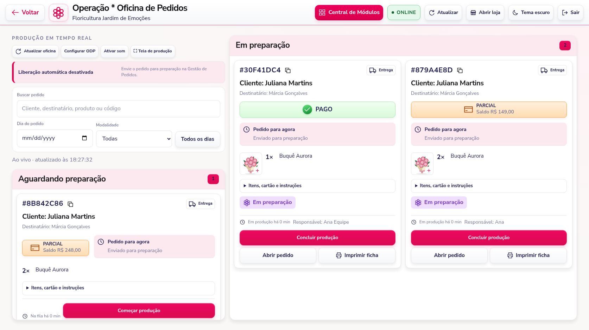
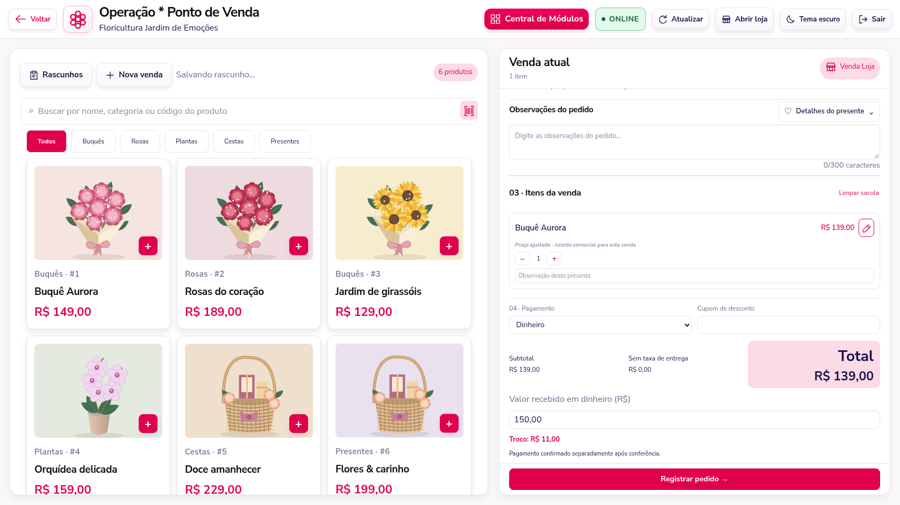
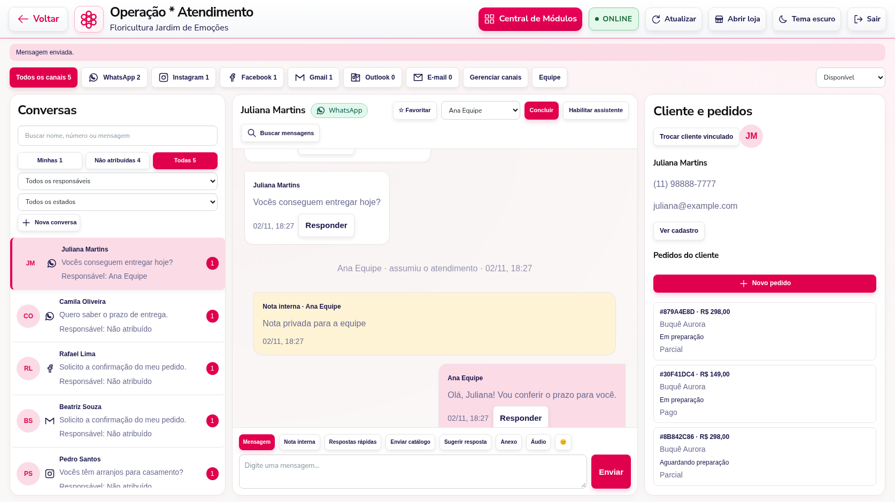
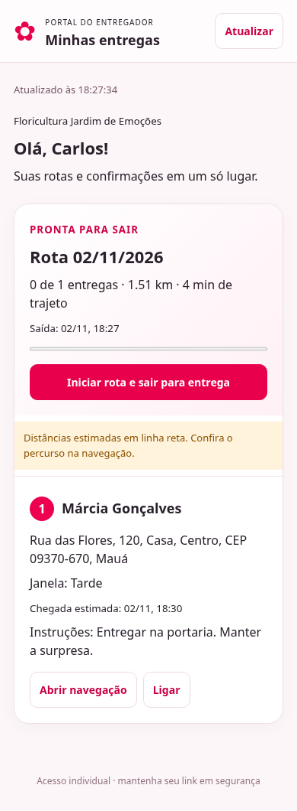
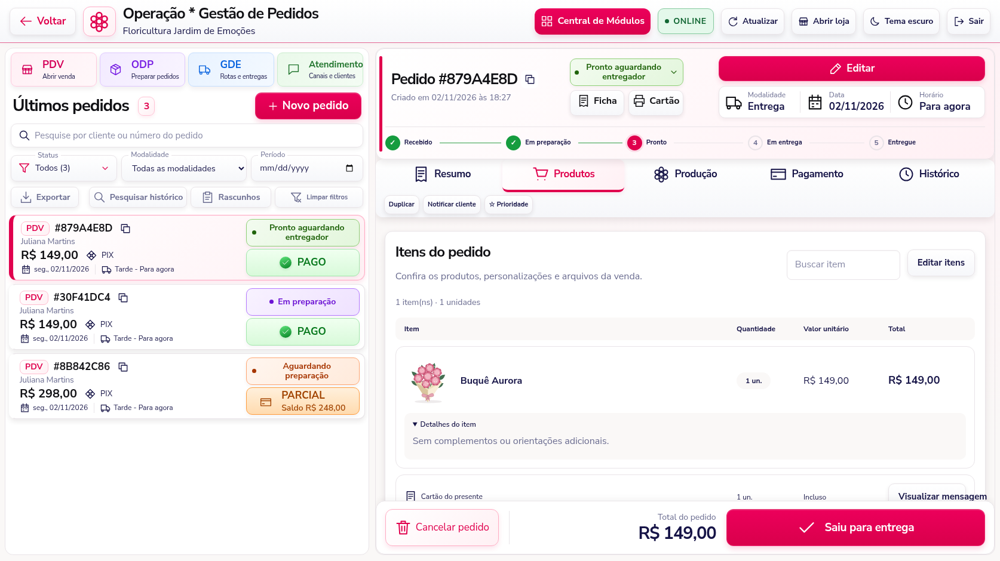

# Operação, atendimento e entregas — 3.16

Esta atualização aplica as referências enviadas à Oficina de Pedidos, PDV, Atendimento, Gestão de Entregas e Gestão de Pedidos. As capturas deste guia usam dados fictícios em um ambiente de teste.

## Atualizar a instalação existente no Windows

1. Pare o servidor com **Ctrl + C** e faça backup do banco e das pastas privadas.
2. Substitua os arquivos do projeto pelo pacote completo desta versão. Preserve `.env`, `.tenants`, `.wwebjs_auth`, `.wwebjs_cache`, `.product-media`, `.order-uploads` e, se já existir, **`.driver-access`**. Preserve também os diretórios personalizados de mídia/fotos usados no seu `.env`.
3. Abra o terminal **na pasta que contém o novo `package.json`** e confira:

```cmd
node -p "require('./package.json').version"
```

O resultado deve ser **3.16.0**. Se aparecer outra versão ou `Missing script`, os arquivos ainda não foram substituídos na pasta em que o terminal está aberto.

4. Instale as dependências e, em SQL Server, as novas tabelas:

```cmd
npm ci
npm run migrate:operations-studio
npm start
```

**Não recrie o banco.** A migração é aditiva, executada em uma transação, e preserva pedidos, clientes, pagamentos e fotos. Em demonstração, não execute a migração SQL: os cadastros dessa modalidade continuam temporários.

Se a conta da aplicação não puder criar tabelas, abra o SSMS, selecione o banco indicado por `SQL_DATABASE` e execute `sql/operations-studio.sql` com uma conta autorizada. A aplicação precisa de acesso de leitura/gravação às novas tabelas de atendimento, equipe, clientes, entregadores e avisos; essas permissões devem ser concedidas pelo responsável do banco. O início do servidor também confere/instala o esquema quando a conta possui permissão.

5. Reabra o painel e use **Ctrl + F5** nas telas abertas. Esta versão usa recursos de navegador com identificação `v=3.16.0` nos arquivos alterados.

## Oficina de Pedidos — ODP

Controles e fila ficam à esquerda, com a produção à direita. Os cartões mostram código copiável, cliente/destinatário, modalidade, pagamento, saldo, agendamento e tempo na fila/produção. Itens, cartão, instruções e fotos continuam acessíveis. Há som para novos pedidos, tela de produção, impressão e conclusão com checklist.

Recebimentos parciais liberam o preparo após a liberação manual ou automática do agendamento. O saldo continua obrigatório antes da entrega ou retirada. A verificação também ocorre na API de início da produção.



## PDV: preço por venda, pagamento e troco

O catálogo e a venda atual foram reorganizados. Observações do pedido ficam visíveis; detalhes do presente continuam acessíveis em um formulário próprio. O leitor de código pode funcionar como teclado, usando SKU ou código do produto e Enter.

O lápis de preço abre **novo preço unitário + motivo obrigatório**. Somente o responsável da loja autoriza essa alteração. Ela afeta o produto principal naquela venda; complementos mantêm suas próprias regras. O catálogo não muda, e o histórico registra valor anterior, novo valor, motivo e operador.

Ao escolher **Dinheiro**, o campo de valor recebido aparece e o troco é calculado imediatamente. Na próxima tela, a forma escolhida e o valor informado já estão preenchidos. PIX e cartão também carregam a opção escolhida. O operador ainda precisa confirmar o recebimento: escolher uma opção no PDV não comprova pagamento. O lançamento proposto pode ser editado e combinado com outras formas.



## Atendimento multicanal e vários atendentes

A nova caixa de entrada agrega os canais conectados: WhatsApp, Instagram, Facebook, Gmail, Outlook e IMAP. Filtros permitem consultar minhas conversas, não atribuídas, todas, responsável, não lidas, favoritas e concluídas. Contagens vêm dos canais e dos registros reais, sem exemplos inseridos na operação.

Em **Equipe**, o responsável cria acessos individuais de atendentes, altera senhas e desativa acessos. Disponibilidade pode ser alterada entre disponível, ocupado e ausente. Senhas são armazenadas com hash; alteração de senha ou desativação encerra as sessões daquele atendente.

**Assumir** vincula a conversa ao usuário conectado. Transferências e alterações usam versão: duas pessoas não podem assumir ou sobrescrever o mesmo atendimento ao mesmo tempo. O atendente atual, ou o responsável da loja, pode transferir. Antes de responder, inclusive como responsável, assuma o atendimento. Conversas concluídas precisam ser reabertas.

O servidor protege os envios de texto e anexos, identifica o operador e evita repetir uma operação cujo resultado já foi recebido. Durante um envio, a transferência fica bloqueada. Em falha de confirmação, confira a conversa antes de tentar outro envio.

**Nota interna** registra informação somente para a equipe, com autor e data, sem encaminhar ao cliente. Mensagens têm respostas rápidas e catálogo; no WhatsApp também há anexos, gravação de áudio com conferência, resposta vinculada e sugestão da assistente. A assistente gera sugestões para revisão do operador.

A coluna do cliente permite vincular cadastro, visualizar/editar seus dados, gerenciar endereços, criar pedidos, abrir histórico, carregar pedidos anteriores, usar tags e salvar notas da equipe. Pedidos vinculados ao cadastro continuam no histórico após alteração do telefone. As alterações do cliente preservam os dados já registrados nos pedidos anteriores.

As conexões continuam em **Gerenciar canais**. Instagram/Facebook exigem credenciais e permissões da Meta; os provedores de e-mail exigem suas conexões. Consulte também `INTEGRACOES-ATENDIMENTO.md`.



## Gestão de Entregas — GDE

A tela organiza pedidos prontos, mapa/equipe e montagem da rota. Há pesquisa, filtros por dia/cidade/período/prioridade/endereço a conferir, seleção de pedidos, sequência com arraste ou setas, rascunhos, rotas em andamento e histórico.

Cada entregador possui telefone, vínculo **CLT / PJ / Freelance**, disponibilidade, capacidade de paradas e tipo de veículo: **moto, carro, caminhão, bicicleta, van ou a pé**. Quem estiver em outra rota ativa não pode iniciar uma segunda rota simultaneamente. Transferências preservam entregas concluídas e registram o motivo.

O planejamento oferece prioridade por horários, menor trajeto sugerido, sequência manual e retorno à loja. Com o serviço ORS configurado, pesquisa endereços e usa perfil rodoviário compatível com o veículo. Localizações com confiança insuficiente precisam de conferência manual. Sem a integração, o sistema usa distâncias em linha reta e identifica essa limitação; não informa trânsito em tempo real. Alterar o veículo em uma transferência invalida a previsão anterior das paradas pendentes.

O mapa de fundo depende do acesso ao OpenStreetMap. Se não carregar, a tela informa a falha; coordenadas e abertura da navegação permanecem disponíveis. Rotas e endereços devem ser conferidos antes do despacho. A otimização é uma sugestão, sem garantia de ótimo matemático ou de condições atuais da via.

**Salvar rascunho** reserva os pedidos sem enviar aviso. **Criar e enviar rota** atribui a rota e agenda o WhatsApp do entregador. O despacho de um rascunho também agenda o aviso. A fila é persistida no banco e aguarda o WhatsApp da própria loja conectar. Um envio de resultado incerto fica para conferência, sem repetição automática. O botão de envio manual pede confirmação para repetir um aviso.

## Domínios e links individuais

A base pública é definida **para cada floricultura**:

| Situação da floricultura | Exemplo de base |
| --- | --- |
| Emoções Flores com seu domínio verificado | `https://floriculturaemocoesflores.com.br` |
| Outra floricultura com domínio próprio | `https://dominio-da-outra-floricultura.com.br` |
| Sem domínio próprio verificado | `https://inovafacil.com.br/nome-da-floricultura` |

`nome-da-floricultura` é o identificador/slug do cadastro da loja. O domínio da Emoções Flores não é usado como padrão das outras lojas. O caminho antigo `/loja/slug` continua disponível.

Em **Configurações → Domínio**, cadastre e verifique o domínio de cada loja pelo TXT informado na tela. Para funcionar na internet, o DNS precisa apontar para o servidor e o proxy precisa encaminhar o **Host original**, com certificado HTTPS válido. A publicação no provedor e a configuração de DNS/TLS são feitas no servidor de hospedagem; substituir os arquivos localmente não publica o localhost na internet.

O endereço principal da plataforma tem padrão `https://inovafacil.com.br`; `PLATFORM_PUBLIC_URL` permite configurá-lo. Em produção HTTPS, use `COOKIE_SECURE=true` na configuração existente. Não é necessário definir o domínio da Emoções Flores em uma variável global.

Cada entregador recebe um endereço individual dentro da base da sua loja, por exemplo:

```text
https://floriculturaemocoesflores.com.br/entregador/IDENTIFICADOR/#CHAVE_PRIVADA
https://inovafacil.com.br/outra-floricultura/entregador/IDENTIFICADOR/#CHAVE_PRIVADA
```

O link pessoal pode ser consultado/copiado em **Entregadores → Link individual**, ou enviado pelo aviso da rota. O acesso móvel mostra apenas rotas atualmente atribuídas àquela pessoa: início, destinatários, telefones, endereços, instruções, horários, navegação, ocorrência e confirmação com nome de quem recebeu. Localização é opcional e depende de autorização do celular. Transferir a rota remove imediatamente o acesso do entregador anterior àquela rota.

A chave do link é trocada por sessão protegida e retirada da barra de endereço. O responsável pode **revogar o link e gerar novo**, encerrando as sessões anteriores. Desativar o entregador também bloqueia o acesso.



**Preserve `.driver-access/key` no backup.** Ela é gerada automaticamente na primeira utilização e protege os links armazenados. Como alternativa, configure `DRIVER_ACCESS_KEY` com uma chave base64 de 32 bytes, idêntica em todas as instâncias do servidor. Se houver várias instâncias sem essa variável, elas precisam compartilhar a mesma chave privada. Trocar/perder a chave impede recuperar os links existentes; será necessário revogá-los e gerar novos.

## Gestão de pedidos e acompanhamento do cliente

O pedido ganhou andamento por etapas, avisos de janela encerrada, resumo de pagamento, vínculo com rota/entregador e prioridade. A aba Produtos mostra imagens, quantidade, valor unitário, total, personalizações, cartão e fotos, com busca.

**Editar itens** permite alterar quantidades, observações, remover e adicionar produtos com complementos/fotos. Exige motivo, prévia dos valores e versão atual. Itens mantidos preservam os preços e arquivos registrados; novos itens usam o catálogo atual. Cupons percentuais e descontos autorizados mantêm sua regra de cálculo. A diferença de estoque, auditoria, arquivos e pedido são gravados na mesma transação.

Reduções não devolvem estoque automaticamente: marque a confirmação somente se as unidades foram fisicamente devolvidas. Se a produção já começou ou o pedido ficou pronto, uma revisão reinicia a conferência. Pedidos em rota/encerrados não aceitam essa edição; rascunhos de rota precisam ser cancelados antes de revisar seus itens. Valores já recebidos são preservados: saldo ou devolução a conferir aparecem conforme o novo total. Nenhuma devolução bancária é executada pelo sistema.

**Duplicar** abre uma nova venda para conferência de cliente, endereço, agendamento, produtos e preços atuais. Não copia recebimentos, descontos, preços exclusivos nem arquivos privados já vinculados a outro pedido; fotos devem ser enviadas novamente.

**Notificar cliente** abre o atendimento interno com texto preparado; o operador confere e envia. Em uma parada da rota, **Compartilhar rastreio** gera link com validade de sete dias que mostra somente o andamento daquele pedido. O link de rastreio do cliente é diferente do acesso privado do entregador.



## Verificações desta entrega

Foram executados testes automatizados de domínio, HTTP, concorrência, autorização, isolamento entre lojas, versões, pagamentos, estoque, revogação de acessos e transações SQL com driver simulado. O navegador foi usado para os fluxos completos, quatro larguras e os temas claro/escuro, incluindo regressão de fotos, complementos e correções de recebimento. A auditoria de dependências não apontou vulnerabilidades conhecidas.

O ambiente de desenvolvimento não possui o SQL Server, as contas de canais e as impressoras da instalação real. Os testes de WhatsApp usaram serviço simulado e não enviaram mensagens reais. Após instalar, valide uma rota de teste com um celular da equipe e confira o envio pelo WhatsApp conectado da loja.
