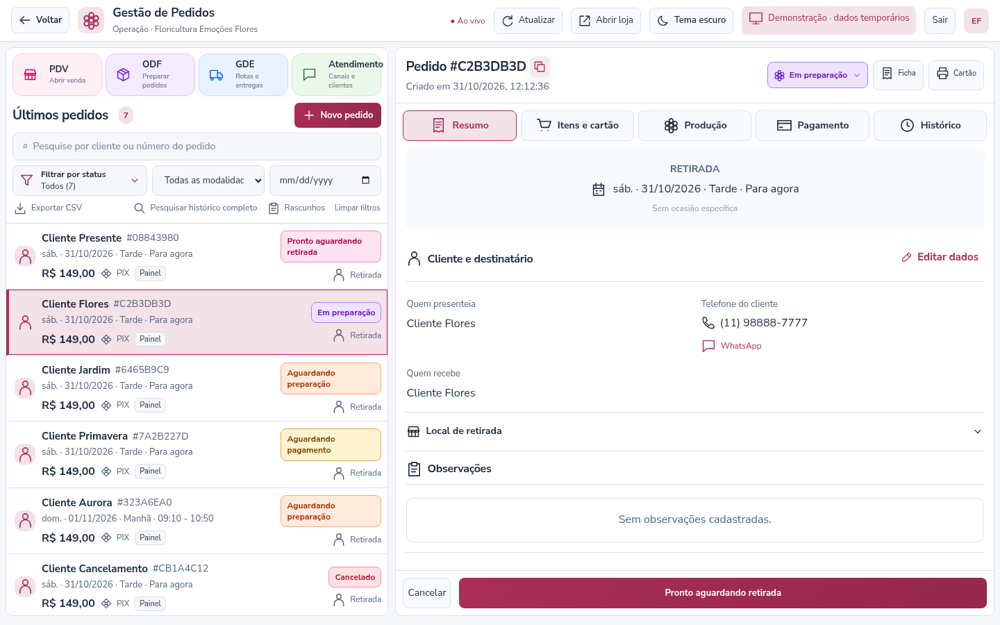
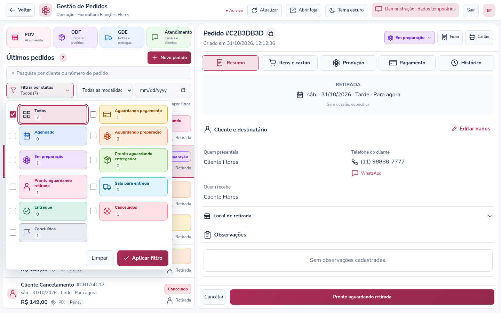
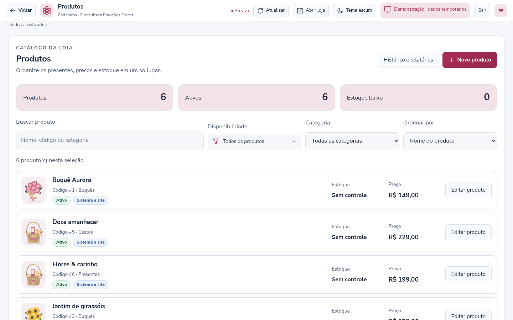

# Painel e filtros de status — versão 3.10

## Gestão de Pedidos no novo formato

A fila e os controles ficam juntos à esquerda; a ficha do pedido ocupa a área maior à direita. Os quatro atalhos **PDV, ODF, GDE e Atendimento** continuam disponíveis no topo da fila, com ícones e cores próprios. Busca, modalidade, data, rascunhos, exportação e histórico permanecem acessíveis nessa coluna.

A ficha tem abas com ícones para **Resumo, Itens e cartão, Produção, Pagamento e Histórico**, além das ações de impressão. O número do pedido pode ser copiado pelo botão ao lado do título. Telefones aparecem com máscara e atalho para ligação; o contato pelo WhatsApp continua disponível.

No Resumo, os dados de cliente/destinatário aparecem primeiro, com acesso direto à edição. O local de retirada fica em uma seção expansível; o endereço de entrega continua visível nos pedidos de entrega. Há uma área própria para observações, com indicação quando não existem observações cadastradas. Os botões de andamento ficam no rodapé da ficha.



## Filtrar por vários status

O botão **Filtrar por status** substitui a faixa de botões. Ao abrir:

1. Marque uma ou mais etapas nos cartões com ícone, cor e quantidade.
2. Clique em **Aplicar filtro** para atualizar a lista.
3. **Limpar** volta a seleção para Todos; aplique para confirmar essa escolha.

Selecionar uma etapa específica desmarca Todos. O filtro mostra pedidos que estejam em **qualquer uma** das etapas selecionadas. Se nenhuma estiver marcada, a aplicação fica desabilitada e aparece a orientação para selecionar uma opção. **Esc** ou clicar fora fecha o seletor sem aplicar as alterações em edição.

As contagens são atualizadas ao vivo sem apagar as escolhas que ainda não foram aplicadas. A navegação pelos módulos mantém o filtro da sessão. Ao recarregar ou iniciar nova sessão, vale a etapa inicial definida em **Configurações → Gestão de Pedidos**. Busca e escolhas da sessão anterior são limpas ao sair.

Busca, modalidade e data continuam funcionando em conjunto com o filtro de status. **Limpar filtros** redefine todos esses critérios. A exportação CSV passa a seguir a lista filtrada, mantendo a proteção existente para campos interpretáveis como fórmulas em planilhas.

As quantidades se referem aos pedidos carregados no painel. Use **Pesquisar histórico completo** para consultar registros mais antigos; o novo seletor não representa uma consulta sem limite a todo o banco.



## Ações de status

O status no cabeçalho da ficha abre as ações disponíveis para aquele pedido. Esse acesso usa as mesmas ações do rodapé: confirmar recebimento, avançar para a próxima etapa ou cancelar com motivo. Pagamento, conferência, entregador, versão do pedido e demais regras continuam sendo verificados no servidor. Pedidos encerrados mostram a etiqueta para consulta, sem oferecer avanço de etapa.

Selecionar um filtro não altera o status de nenhum pedido. A preparação e a confirmação de recebimento continuam sendo ações próprias, com os registros já existentes no histórico.

## Padrão visual compartilhado

Os módulos administrativos e a gestão Inova compartilham superfícies, bordas, cabeçalhos, tipografia, botões e ícones locais. Os temas claro/escuro e as preferências de cores e leitura da floricultura continuam disponíveis. O PDV usa o mesmo cabeçalho da operação.

O mesmo componente de filtro também aparece em **Produtos → Disponibilidade** e no filtro de cobranças do **Financeiro da Inova**. Nessas telas a escolha é única, respeitando o funcionamento anterior de cada consulta, com a confirmação em Aplicar filtro. Formulários de cadastro mantêm seus seletores próprios.



Controles e cartões da loja pública recebem bordas e espaçamentos coerentes com essa linguagem visual, mantendo a identidade e o layout configurados para o e-commerce. Os ícones são arquivos vetoriais criados localmente pelo navegador, sem serviço externo ou fonte de ícones adicional.

No celular, fila e ficha ficam em sequência. O filtro possui rolagem interna quando necessário, mantendo as ações acessíveis. As escolhas podem ser feitas pelo teclado; os rótulos permanecem visíveis, sem depender apenas da cor.

## Atualização

**Para quem já está na versão 3.9, não há nova tabela, migração SQL ou variável obrigatória no `.env`.** Preserve o banco, `.env` e pastas privadas. Pare o servidor com Ctrl+C, atualize os arquivos e execute na pasta do projeto:

```bat
npm ci
npm run media:setup
npm audit
npm start
```

Depois use **Ctrl+F5 em todas as telas abertas**.

Se estiver vindo da **3.8 ou anterior**, observe também o [guia da 3.9](RASCUNHOS-E-OFICINA-3.9.md): os rascunhos do PDV precisam de `sql/pdv-drafts.sql` no banco configurado e das permissões indicadas naquele guia. Não recrie o banco.

## Validação

**150 testes automatizados aprovados** e auditoria sem vulnerabilidades conhecidas nesta entrega. No Chromium foram conferidos os 21 módulos, navegação, mídias, recebimentos divididos/parciais, recuperação de registro e cabeçalhos. O filtro foi exercitado com múltiplas escolhas, cancelamento sem aplicar, atualização ao vivo das contagens, preservação da seleção em edição, exportação filtrada e reinício de sessão. Produtos e Financeiro Inova também foram verificados.

Fila/ficha e seletor foram conferidos em sete resoluções, nos dois temas, incluindo teclado, rolagem e visibilidade do rodapé. As cores do seletor foram verificadas quanto à distinção e ao contraste do texto. As imagens usam dados fictícios em demonstração; o SQL Server do computador da loja e impressoras físicas não foram acessados neste ambiente.
