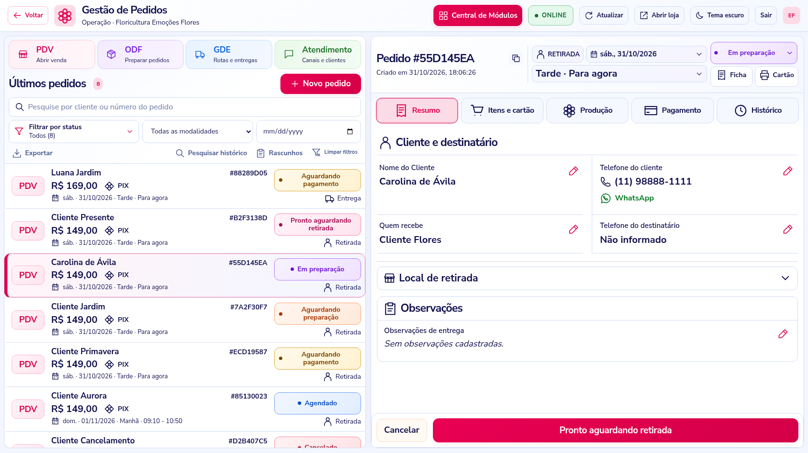
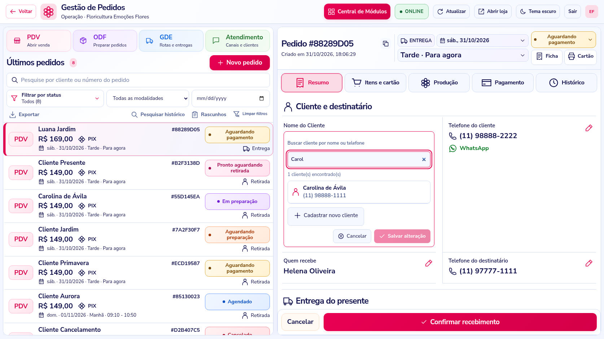
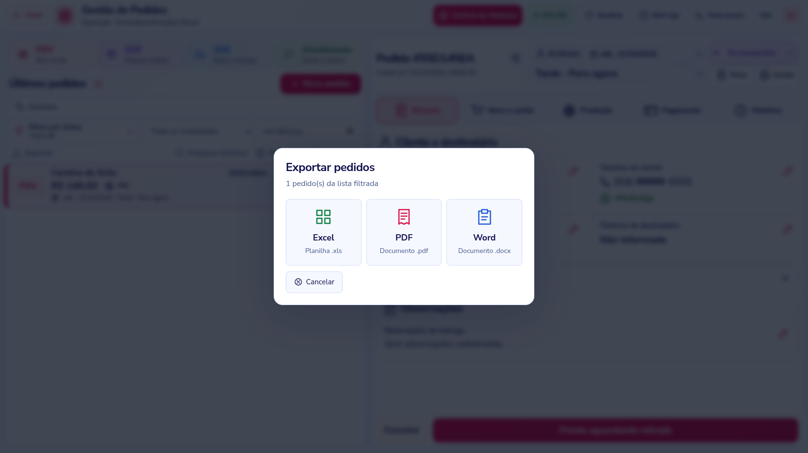

# Painel premium, cadastros e exportação — 3.12

## Organização da referência

A operação usa azul profundo, rosa vivo, cartões claros, bordas suaves, ícones maiores e status com cores próprias. O tema escuro segue a mesma organização. Os estilos compartilhados também são usados pela Central de Módulos, PDV, cadastros, configurações e gestão Inova.

Na Gestão de Pedidos:

- Os atalhos PDV, ODF, GDE e Atendimento ficam no topo da coluna esquerda, seguidos por busca, filtros e ferramentas.
- Cada pedido mostra o canal de origem em um cartão lateral. A primeira linha contém cliente e código; **a segunda contém valor e pagamento; a terceira contém data, período e horário**.
- As etiquetas mantêm as mesmas dimensões em todas as etapas.
- A ficha tem data/período no cabeçalho, status, impressões e abas Resumo, Itens e cartão, Produção, Pagamento e Histórico.
- Cliente e destinatário ficam no início do Resumo. O local de retirada é expansível. As observações têm cartão próprio e a ação principal fica no rodapé.
- Central de Módulos, Voltar, ONLINE/OFFLINE, filtros e rascunhos continuam disponíveis.

A modalidade exibida no cabeçalho é a modalidade registrada na venda. As restrições de expedição e encerramento continuam sendo aplicadas pelo servidor. A nova apresentação não habilita uma troca de modalidade que desconsidere frete ou recebimentos.



## Nome do Cliente e endereço

O rótulo **Quem presenteia** passa a ser **Nome do Cliente**. O lápis abre uma busca por nome ou telefone, semelhante à do PDV. Selecione um cliente cadastrado ou use **Cadastrar novo cliente**. A busca aceita teclado, cancela consultas antigas e limita os resultados a 20; refine o termo quando necessário.

Ao selecionar o cliente, nome e telefone vêm do cadastro da loja. Clique em **Salvar alteração** para vincular os dados ao pedido. Se for um pedido de entrega e você estiver trocando de cliente, escolha também um destino desse novo cliente antes de salvar. A troca de cliente e de destino ocorre de uma vez no pedido.

No lápis do endereço, o sistema abre os destinos salvos do cliente. É possível selecionar outro endereço ou cadastrar um novo usando CEP, rua, número, complemento, destinatário e telefone. A busca de CEP auxilia o preenchimento; os campos continuam disponíveis se o serviço de CEP estiver indisponível. Não é mais necessário reescrever um endereço completo em um campo livre na ficha.

Se um pedido antigo ainda não tiver cliente vinculado, o sistema tenta localizar o cadastro pelo telefone. Se não encontrar, orienta a selecionar ou cadastrar o cliente pelo campo Nome do Cliente.

Criar um cliente ou salvar um endereço grava esse cadastro para uso futuro. A escolha só altera o pedido quando você confirma **Salvar alteração** na ficha. A taxa de entrega e os recebimentos originais seguem preservados pelo fluxo de edição existente; as correções financeiras têm seu fluxo próprio.

As alterações do pedido continuam com usuário da sessão, horário, versão e valores antes/depois nas tabelas de auditoria da 3.11. Um endereço modificado em outra tela exige nova seleção. Busca em andamento e texto de edição são preservados durante a atualização ao vivo.



## Exportar

O botão **Exportar** abre três opções:

- **Excel (.xls)**: arquivo binário Excel 97–2003 real, com colunas, filtro e valores monetários numéricos. Não é CSV renomeado.
- **PDF (.pdf)**: relatório em A4 paisagem, com fontes incorporadas, cabeçalhos repetidos e paginação.
- **Word (.docx)**: documento editável com tabela, pagamento e total.

Os arquivos seguem **a lista filtrada e sua ordem**, até 1.000 pedidos por exportação. A planilha traz código, cliente, destinatário, data, período, horário, modalidade, cidade, status, pagamento, canal e total. PDF e Word organizam os principais dados em tabela para leitura e impressão. A seleção se refere aos pedidos carregados na tela, não a uma busca ilimitada em todo o banco.

O servidor recebe somente os códigos e o formato, consulta os dados da loja autenticada e não aceita exportar pedidos de outra loja. O arquivo não fica salvo no servidor. A consulta SQL carrega somente os campos necessários à exportação, sem trazer o histórico completo.



## Atualizar pelo Prompt

Se você já está na **3.11 e instalou `sql/order-events.sql`**, esta atualização **não exige novo script SQL**.

1. Pare o servidor com **Ctrl + C**.
2. Atualize os arquivos e preserve o `.env`, banco, mídias e sessões da instalação.
3. Na pasta onde está `package.json`, execute:

```cmd
npm ci
npm start
```

4. Recarregue o navegador com **Ctrl + F5**.

Se estiver vindo de versão anterior à 3.11, aplique primeiro [sql/order-events.sql](sql/order-events.sql) no banco atual, seguindo [o guia da auditoria](EDICAO-E-HISTORICO-3.11.md). Não recrie o banco. O comando opcional de migração de histórico antigo continua disponível.

## Verificação

**157 testes automatizados passaram**, e a auditoria de dependências encontrou **zero vulnerabilidades conhecidas**. Foram verificados os arquivos XLS, PDF e Word, os dados reais dos cadastros selecionados, o vínculo de endereço/cliente, rejeição de versões antigas, autenticação, isolamento entre lojas e histórico. O navegador foi usado para testar seleção e cadastro de cliente, endereços salvos e novo endereço com CEP, troca completa de cliente/destino, downloads nos três formatos, preservação de busca durante atualizações e oito resoluções nos dois temas. Os 21 módulos abrem e retornam à central sem erros de JavaScript. A suíte automatizada e a auditoria de dependências acompanham a entrega. Não foi executada migração ou benchmark no SQL Server da instalação.
