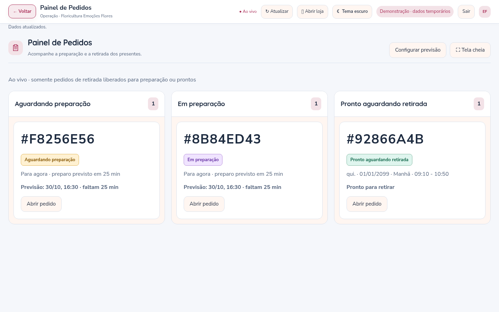

# Pedidos, Oficina e Retiradas — versão 3.7

## Voltar para a tela de origem

Na Gestão de Pedidos, os atalhos PDV, ODF, GDE e Atendimento mantêm o caminho percorrido. **← Voltar** retorna à Gestão de Pedidos quando o módulo foi aberto por ela. Ao abrir um módulo diretamente pela central, o retorno é para a central. O PDV continua preservando a tela que estava atrás da venda e agora mostra o texto **Voltar**, além da seta.

## As mesmas etapas em todas as telas

Servidor, Gestão de Pedidos, ODF, Atendimento, rotas e Painel de Pedidos usam uma definição compartilhada das etapas. Aguardando pagamento e Agendado continuam existindo antes da liberação do preparo.

| Situação | Etapa compartilhada |
| --- | --- |
| Pedido pago, liberado para a oficina, ainda sem iniciar o trabalho | **Aguardando preparação** |
| Equipe começou a preparar o pedido | **Em preparação** |
| Entrega conferida e pronta | **Pronto aguardando entregador** |
| Retirada conferida e pronta | **Pronto aguardando retirada** |
| Entregador saiu com o pedido | **Saiu para entrega** |
| Entrega confirmada | **Entregue** |
| Pedido encerrado | **Concluído** |

A ODF tem somente **Aguardando preparação** e **Em preparação**. Ao conferir e concluir o preparo, o pedido sai da ODF e recebe a etapa pronta correspondente à modalidade. A GDE recebe as entregas prontas para planejar a rota. A expedição continua exigindo entregador. A retirada é concluída com **Confirmar retirada e concluir**. Para entregas, a confirmação gera **Entregue**; depois, **Concluir pedido** encerra o atendimento. Não há confirmação automática de que o cliente recebeu um produto sem uma ação da equipe.

Pedidos “para agora” pagos entram diretamente em **Aguardando preparação**, sem aguardar a automação dos agendados. Para pedidos agendados, continuam valendo a antecedência configurada e a verificação das impressoras. O serviço de prazos verifica a elegibilidade a cada segundo; alterações de pagamento/configuração também acionam a conferência. A disponibilidade das impressoras pode atrasar essa liberação, mas sua consulta não bloqueia mais a leitura da fila da ODF.

## Venda Loja

A modalidade agora se chama **Venda Loja** no PDV, nos formulários e na identificação dos pedidos. Ela **não passa na ODF**. Ao confirmar o recebimento, a venda é encerrada automaticamente como **Concluído**, com registro no histórico.

Registrar uma venda ainda não confirma pagamento. Até a conferência do recebimento, ela permanece em **Aguardando pagamento**. Isso evita registrar dinheiro recebido sem a confirmação da equipe. As formas de pagamento e a conferência manual continuam sendo as já utilizadas pela loja.

## Painel de Pedidos exclusivo para retirada

Em **Operação → Painel de Pedidos**, há três colunas com números grandes dos pedidos:

- **Aguardando preparação**;
- **Em preparação**;
- **Pronto aguardando retirada**.

“Aguardando retirada” e “Pronto aguardando retirada” representam a mesma situação de pedido conferido esperando o cliente; o painel usa a etiqueta completa para manter a informação igual à da Gestão de Pedidos. Entregas, Venda Loja, pedidos sem pagamento confirmado e pedidos já concluídos/cancelados não aparecem. Agendados futuros entram quando forem liberados para preparação, automaticamente ou pela equipe.

O painel é autenticado e pode ser colocado em tela cheia em um computador ou monitor da loja. O botão **Abrir pedido** leva à Gestão de Pedidos; Voltar retorna ao painel. Por padrão, o painel exibe o código curto já usado no sistema, sem mostrar o nome do cliente. Nas configurações é possível habilitar o nome. A consulta mostra até 500 retiradas ativas e avisa quando o limite é atingido.



### Previsão de preparo

Use **Configurar previsão**, dentro do painel, ou **Configurações → Painel de Pedidos**. Cada floricultura define seu próprio tempo para pedidos “para agora”, entre 1 e 1.440 minutos; o padrão inicial é **30 minutos**.

- **Para agora:** a previsão é o horário de confirmação do recebimento mais o tempo de preparo. O tempo configurado fica registrado nos novos pedidos, preservando a estimativa quando a configuração mudar depois.
- **Agendado:** o cartão mostra o dia e o intervalo escolhido; o contador usa o início do intervalo como referência da previsão. O intervalo completo continua visível.
- **Pronto:** o painel informa **Pronto para retirar**, sem continuar a contagem de preparo.

O contador muda localmente a cada segundo, sem consultar o banco para cada segundo exibido. A previsão é uma estimativa: não muda o pedido para pronto sem a conferência. Pedidos antigos sem faixa exata não recebem um horário inventado; o painel orienta confirmar o horário no pedido.

## Atualização ao vivo

As alterações gravadas pela aplicação são notificadas pelo servidor por uma conexão autenticada de eventos, separada por floricultura. A Gestão de Pedidos, a ODF, a GDE, o painel de retiradas e as consultas de pedidos do Atendimento recebem a atualização sem esperar a antiga consulta periódica de cinco/dez segundos. Cadastros e configurações também notificam as telas, preservando formulários em edição e a conferência de versão para evitar sobrescrever alterações de outra pessoa.

O cabeçalho mostra **Ao vivo** ou **Reconectando**. Ao restabelecer a conexão, as telas consultam novamente o estado atual. Ao retornar a uma aba que o navegador havia colocado em segundo plano, também há reconciliação. O tempo observado no teste local foi inferior a 100 ms para encaminhar pedidos à outra tela; esse valor não é garantia para todas as redes e computadores.

Nesta versão, as notificações conectam as telas atendidas pela **mesma instância Node** — a instalação atual com `npm start`. Uma futura hospedagem com vários processos/servidores simultâneos precisa de um distribuidor compartilhado de eventos antes de habilitar múltiplas instâncias. Proxies devem permitir streaming sem buffering. Alterações feitas diretamente no SQL, fora da aplicação, não geram esses eventos.

Este fluxo sincroniza os dados internos dos pedidos e da operação. A chegada de novas mensagens de serviços externos continua dependendo do conector e das permissões do respectivo provedor; não foi substituída nesta versão a sincronização dos provedores Meta/e-mail por webhooks.

## Pedidos existentes e atualização

Não há nova alteração de esquema SQL nem variável obrigatória de `.env` em relação à 3.6.1. Pedidos antigos continuam legíveis: “Em preparação” sem registro de início é interpretado como aguardando preparação; com início registrado, permanece em preparação. “Pronto” passa a indicar o destino conforme a modalidade; “Retirado” e “Concluído na loja” são exibidos como Concluído. Venda Loja já paga também é exibida como Concluído. Essa interpretação não reescreve os textos do histórico nem faz uma atualização em massa no banco; as novas ações persistem as etapas atuais normalmente.

Pare o servidor com **Ctrl+C**, faça seu backup habitual e atualize os arquivos, preservando `.env`, banco, `.tenants`, `.product-media`, `.wwebjs_auth`, `.wwebjs_cache` e os demais dados privados. Execute na pasta do projeto:

```bat
npm ci
npm run media:setup
npm audit
npm start
```

Depois pressione **Ctrl+F5 em todas as telas abertas**. A auditoria desta versão informou zero vulnerabilidades conhecidas.

## Validação

**130 testes automatizados** aprovados, incluindo ciclo completo por modalidade, isolamento dos eventos, notificações entre sessões, rejeição de versões antigas, etapas legadas, Venda Loja, configuração individual da previsão e cálculo dos horários.

No navegador foram exercitados os quatro atalhos e seus retornos; telas simultâneas de Gestão, ODF e GDE; liberação, início e conclusão; saída da ODF; painel de retiradas com as três etapas; configuração do tempo de preparo; Venda Loja; dois temas e resoluções de computador, tablet e celular. A regressão dos 21 módulos, navegação, fotos e vídeos também passou. O SQL Server do computador do cliente e impressoras físicas não foram acessados neste ambiente.
