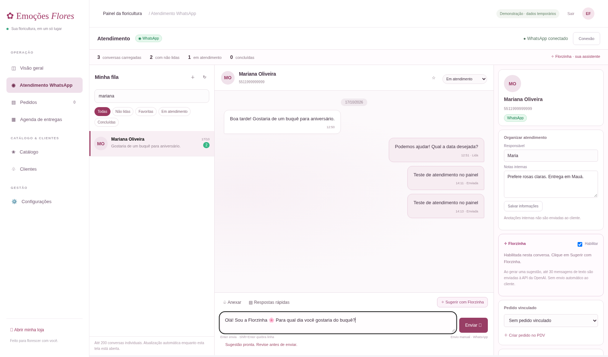
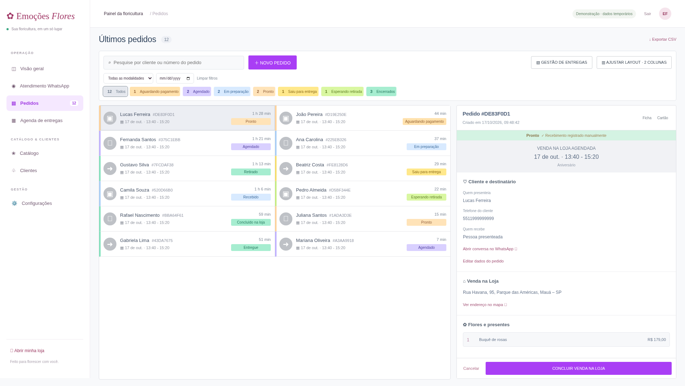

> **Versão 3.9:** rascunhos automáticos do PDV por operador, correção da configuração/liberação da ODF, lista menor com ficha ampliada e cores distintas por status. **Nova tabela SQL:** [guia de atualização](RASCUNHOS-E-OFICINA-3.9.md).

> **Versão 3.8:** recebimentos divididos/parciais com histórico, descontos e troco; pedidos sem duplicação, concluídos ao fim, cabeçalhos e ícones unificados, fotos ampliáveis na ODF: [guia da atualização](RECEBIMENTOS-E-VISUAL-3.8.md).

> **Versão 3.7:** pedidos ao vivo, retorno à tela de origem, etapas compartilhadas, Venda Loja com conclusão após recebimento e Painel de Pedidos exclusivo para retiradas: [guia da atualização](PEDIDOS-AO-VIVO-3.7.md).

> **Versão 3.6.1:** correção dos dois alertas altos na cadeia de autenticação Azure do driver SQL Server; auditoria sem vulnerabilidades conhecidas: [guia da correção](SEGURANCA-3.6.1.md).

> **Versão 3.6:** atalhos PDV/ODF/GDE/Canais restaurados, Oficina de Flores como KDS, preparação automática com verificação das impressoras e agendamentos com prazos e capacidade: [guia de configuração e atualização](ODF-E-AGENDAMENTOS-3.6.md).

> **Versão 3.5:** central com vinte módulos em tela ampla, botão Voltar e correção/conversão de fotos e vídeos: [guia da atualização](CENTRAL-E-MIDIAS-3.5.md).

> **Versão 3.4:** produtos em lista, cadastro por abas, estoque auditado, mídias, promoções, SEO e complementos: [guia de produtos e atualização](PRODUTOS-3.4.md).

> **Versão 3.3:** PDV compacto, lista de pedidos com dados completos, cores por etapa e grupos do menu retráteis: [guia da operação](OPERACAO-3.3.md).

> **Versão 3.2:** central de configurações por módulo, aparência independente do painel/e-commerce e cadastro/verificação DNS de domínio: [guia](CONFIGURACOES-3.2.md).

> **Versão 3.1:** Gestão de Pedidos primeiro em Operação, módulos em destaque e relatório unificado personalizável: [guia do painel](PAINEL-3.1.md).

> **Versão 3.0:** novos menus e módulos operacionais, categorias múltiplas, caixa e rotas: [guia dos módulos e limitações de integração](MODULOS-DA-LOJA.md).

> Visual creme, rosa e lavanda, novas funções de catálogo e bairros de Mauá: [notas da versão 2.5](VISUAL-E-BAIRROS.md).

> Atendimento, pedidos do cliente e configuração de Instagram, Facebook e e-mail: [guia de integrações](INTEGRACOES-ATENDIMENTO.md).

> Plataforma com lojas separadas, login e assistentes personalizadas: leia [PLATAFORMA.md](PLATAFORMA.md) antes de atualizar uma instalação existente.

# Floricultura Emoções Flores

Loja e central de pedidos em português para **Mauá, Santo André e Ribeirão Pires (SP)**, com Node.js 24, Express e SQL Server. Retirada gratuita: **Rua Havana, 95, Parque das Américas, Mauá – SP**. Frete inicial de **R$ 20**, alterável pelo painel.

## Iniciar no Windows

Abra o terminal na pasta que contém `server.js` e `package.json`:

```bat
npm ci
copy .env.example .env
notepad .env
```

Defina uma chave longa e exclusiva em `ADMIN_TOKEN`, mantenha `DATA_MODE=demo` para experimentar sem banco, salve e execute:

```bat
npm start
```

Com o processo ativo, abra na própria máquina:

- Loja: `http://localhost:3000`
- Gestão Inova: `http://localhost:3000/inova.html`
- Administração da floricultura: `http://localhost:3000/painel/emocoes-flores`
- Site da floricultura: `http://localhost:3000/loja/emocoes-flores`

O painel da plataforma usa usuário e senha. `ADMIN_TOKEN` é usado apenas na configuração inicial do administrador principal. Para migrar e cadastrar outras lojas, siga [PLATAFORMA.md](PLATAFORMA.md). O `.env` não deve ser enviado ao GitHub. Em demonstração, pedidos e mudanças de frete ficam em memória e desaparecem ao reiniciar. Não use dados pessoais reais nesse modo. Para atualizar uma instalação existente, siga **ATUALIZAR-WINDOWS.txt**; preserve seu `.env`.

## SQL Server local

Crie um banco exclusivo `Floricultura`. Configure TCP/IP e uma porta fixa para a instância. Use uma conta SQL dedicada, sem `sysadmin`. O driver atual usa autenticação SQL, não autenticação integrada do Windows. No `.env`:

```env
DATA_MODE=sqlserver
SQL_HOST=localhost
SQL_PORT=1433
SQL_DATABASE=Floricultura
SQL_USER=floricultura_app
SQL_PASSWORD="preencha_apenas_no_seu_computador"
SQL_TRUST_CERTIFICATE=false
```

A porta deve corresponder à sua instância. A conexão é criptografada. Somente em desenvolvimento local com certificado próprio, use `SQL_TRUST_CERTIFICATE=true`; em produção, use certificado confiável e `false`.

`sql/schema.sql` cria `dbo.Orders` e `dbo.StoreSettings`, sem redefinir a taxa. A versão 1.3 adiciona o cadastro independente `dbo.Customers` por meio de **sql/customers.sql**. Execute os scripts no SSMS com uma conta autorizada a criar tabelas; para a instalação padrão o banco é `Floricultura`. O script de clientes contém `USE [Floricultura]`; se configurou outro banco, ajuste essa linha antes de executar. Na plataforma, a conta da aplicação precisa de SELECT, INSERT e UPDATE nas tabelas utilizadas e DELETE em dbo.AppSessions para encerrar sessões. Não é necessário conceder `db_ddladmin` à aplicação.

Em uma instalação nova, crie o banco, selecione-o no SSMS, execute `sql/schema.sql` e depois `sql/customers.sql`. Em uma instalação anterior à versão 1.3, execute somente `sql/customers.sql`. Para ativar esta versão com várias lojas, execute também `sql/multitenant.sql`, mesmo que `dbo.Customers` já exista. O aplicativo informa a ausência do cadastro caso você tente iniciar antes dessa etapa.

A versão 1.3 **adiciona uma tabela de clientes e não exige recriar o banco**. O script pode ser executado novamente: não apaga pedidos, não redefine clientes existentes e importa nomes/telefones válidos dos pedidos anteriores, agrupados pelo WhatsApp normalizado. Os campos dos pedidos, preços registrados, histórico e versão continuam usando a coluna JSON existente. Pedidos antigos continuam legíveis: histórico e preços individuais antigos não são inventados, e o total original é preservado. Alterações SQL usam transação com bloqueio da linha e conferência de versão para evitar sobrescrever uma operação feita em outra tela.

O proprietário confirmou a conexão da primeira versão com seu SQL Server local. Os novos fluxos desta atualização foram testados em demonstração neste ambiente; a persistência dessas novas operações ainda deve ser conferida na máquina do proprietário. O SQL Server local não é acessível automaticamente pela nuvem. Não exponha a porta do banco à internet.

## PDV · Novo pedido

O botão **Novo pedido** abre uma tela de PDV com catálogo à esquerda e resumo da venda à direita. Há busca por nome, categoria ou código do produto, categorias, adição rápida, quantidades, observação por item e totais calculados no servidor.

Os três primeiros campos do resumo são:

1. **Cliente:** busca por nome ou WhatsApp no cadastro do banco, com navegação por teclado. A opção **Novo cliente** abre cadastro separado, aproveitando o texto digitado. Somente nome e WhatsApp são obrigatórios. Venda Loja continua aceitando consumidor final, desde que a busca esteja limpa.
2. **Modalidade:** Venda Loja (padrão), Retirada, Entrega.
3. **Atendimento:** Pedido para agora (padrão), Realizar agendamento.

Cliente é quem compra. O destinatário do presente fica em outro campo: selecionar o comprador não preenche automaticamente o endereço nem o nome de quem recebe. Retirada e entrega exigem selecionar um cliente cadastrado no PDV e informar destinatário; entrega exige endereço e cidade atendida.

**Pedido para agora** não reserva hora e recebe data/período do servidor no fuso de São Paulo. **Realizar agendamento** abre uma janela para escolher dia e faixa; Cancelar/fechar preserva a escolha anterior e a ação “É um pedido para agora?” remove o agendamento. Sem regras próprias, o seletor oferece os próximos 90 dias e as faixas iniciais 09:10–10:50, 10:50–12:30, 13:40–15:20, 15:20–17:00 e 17:00–18:40. Em **Cadastros → Agendamentos**, cada loja pode ativar dias, datas bloqueadas, faixas, antecedência mínima/máxima e capacidade por intervalo. Site, PDV e reagendamento conferem essas regras no servidor; faixas lotadas ficam indisponíveis. A preparação automática da ODF tem configuração separada. Leia [o guia da versão 3.6](ODF-E-AGENDAMENTOS-3.6.md).

Venda na loja e retirada não cobram frete. Entrega exige endereço e cidade atendida, cobrando a taxa configurada. Ocasião, mensagem, substituição e cuidados com o presente ficam nos campos expansíveis. O botão **Registrar pedido** salva a venda e abre **Confirmar recebimento**, com registros divididos/parciais, desconto autorizado e troco em dinheiro. Confirmar exige a conferência da equipe; fechar mantém o pedido aguardando pagamento. O histórico preserva valores, formas, data/hora e usuário. O Caixa contabiliza cada recebimento na respectiva data, excluindo troco. Venda Loja é concluída após a quitação; retirada e entrega seguem o fluxo de produção. O PDV salva rascunhos no servidor, por operador e floricultura; em demonstração eles ficam na memória do servidor. Leia [o guia da versão 3.9](RASCUNHOS-E-OFICINA-3.9.md) para instalar a tabela SQL e retomar vendas. Leia [o guia da versão 3.8](RECEBIMENTOS-E-VISUAL-3.8.md) para configurar os meios, entender descontos, reenvios e atualização.

## Cadastro de clientes

O menu **Clientes** consulta os cadastros do banco, independentemente de terem pedidos. No PDV, pesquise por nome (sem diferenciar acentos/maiúsculas) ou telefone parcial/formatado e selecione o resultado. A lista retorna até 20 resultados por consulta em toda a tabela; refine a busca quando necessário. Não existe limite vinculado aos 200 pedidos carregados no painel.

**Novo cliente** pode ser aberto pelo PDV ou pelo menu Clientes. Nome (mínimo de 3 caracteres) e WhatsApp brasileiro com DDD são os únicos campos obrigatórios. E-mail, nascimento, gênero, CEP, endereço, preferências de flores/presentes e notas internas são opcionais; se preenchidos, têm validação de formato. O telefone é normalizado com prefixo 55 e protegido por restrição única no banco. O sistema valida o formato, mas não verifica se existe uma conta ativa no WhatsApp.

Depois de salvar pelo PDV, o cadastro é selecionado automaticamente sem perder o carrinho ou o agendamento. O novo pedido guarda `customerId` e uma cópia do nome/telefone recuperados pelo servidor. A busca não usa os dados dos últimos pedidos, e falhas de rede não são tratadas como cliente inexistente. Notas e dados opcionais não aparecem na lista resumida; o perfil completo é acessível somente na área administrativa. O perfil principal pode ser consultado; edição/exclusão dos dados principais ainda não foram implementadas. Os endereços de entrega e destinatários podem ser cadastrados e editados pela janela de entregas, mantendo histórico. Alterar um pedido não altera automaticamente o cadastro do comprador nem o histórico de outros pedidos.

No SQL Server, a tabela `dbo.Customers` mantém identidade, nome, telefone único por floricultura e os opcionais em JSON. Em demo, esse cadastro é independente e fica em memória, sendo perdido ao reiniciar. O script de importação recupera contatos válidos de pedidos antigos sem modificar esses pedidos. Cadastros futuros de clientes feitos apenas na loja pública não são automaticamente incorporados ao diretório nesta versão; o operador pode cadastrá-los pelo painel. As rotas de cadastro e busca exigem sessão autenticada da floricultura. Não existem envios automáticos pelo WhatsApp.

## Entregas: endereços e destinatários por cliente

A versão 1.4 aplica máscara aos telefones e CEPs durante a digitação. Telefone brasileiro é exibido como `(11) 99999-9999` ou `(11) 9999-9999`; o cadastro continua normalizado com prefixo 55 no servidor.

Depois de escolher o cliente no PDV, selecionar **Entrega** abre a janela de entrega. Ela lista os endereços salvos desse comprador ou permite adicionar outro. Cada endereço pode ter uma identificação (ex.: Casa da mãe, Trabalho), CEP, rua, **número obrigatório**, bairro, complemento, referência, cidade/UF e **nome e telefone de quem recebe o presente**. Número precisa conter ao menos um dígito. Rua, bairro, CEP, cidade atendida e os contatos do destinatário são validados também no servidor. Complemento, referência e identificação são opcionais.

Ao digitar um CEP completo, o servidor consulta **https://viacep.com.br** para preencher rua, bairro, cidade e UF. Só o CEP é enviado ao provedor, não nomes ou telefones. A máquina que executa o Node precisa de acesso HTTPS a esse domínio; não há chave de API. CEP inválido, serviço indisponível ou campos vazios retornados pelo provedor são informados na tela, permitindo preencher os campos manualmente. A consulta não localiza número e complemento. Uma resposta atrasada não substitui outro CEP nem campos que o operador está digitando manualmente. Não é uma validação geográfica da existência do imóvel e não altera a área atendida: Mauá, Santo André e Ribeirão Pires/SP.

Use **Novo endereço** para cadastrar outro destino, **Editar** para alterar o mesmo endereço e **Histórico** para consultar as versões anteriores. Endereços diferentes podem ter destinatários diferentes. Salvar pelo PDV seleciona o endereço para aquela compra. Cancelar preserva o cadastro e a seleção anteriores; cancelar a primeira entrega volta à modalidade anterior. É possível gerenciar esses endereços também pelo perfil do cliente em **Clientes → Ver cadastro → Gerenciar endereços e destinatários**.

**Histórico preservado:** todos os endereços ficam no cadastro, sem exclusão pela interface. Cada edição mantém data/hora, ator genérico Administrador e os valores antes/depois, sem truncar versões antigas. O pedido guarda uma cópia do endereço e destinatário escolhidos, com identificador e versão. Editar o cadastro para uma compra futura não altera pedidos anteriores. Uma edição específica nos dados de um pedido permanece no histórico daquele pedido e não muda o cadastro de destinos. Se o endereço foi alterado em outra tela antes de finalizar o pedido, a versão é conferida e o operador precisa revisar a escolha.

Os endereços e suas versões usam o JSON de `dbo.Customers`; pedidos usam o JSON já existente de `dbo.Orders`. As atualizações do cadastro usam transação e bloqueio da linha para preservar outros endereços do mesmo cliente. **Não há nova migração SQL nesta versão** para quem já executou `sql/customers.sql`. Em demonstração, endereços/históricos também ficam em memória e somem ao reiniciar. O diretório de destinos é administrativo e não é exposto a compradores anônimos da loja pública. O checkout público continua como pedido de visitante sem acesso ao catálogo privado de endereços; a máscara também funciona nele.

## Ateliê de pedidos

Inspirado nas referências de operação enviadas pelo proprietário, adaptado à produção floral:

- Lista/cartões e pedido selecionado lado a lado no computador; disposição vertical no celular.
- Abas para andamento, pagamento, ateliê, prontos, entrega/retirada e histórico.
- Busca por nome, destinatário, telefone ou código; filtros por modalidade e data.
- Novo pedido manual com produtos do catálogo, quantidades e observações de cada item. Preço e frete são calculados no servidor; nomes e preços dos novos itens são preservados no pedido.
- Edição de cliente, destinatário, telefones, endereço, agendamento, ocasião, mensagem e orientações, preservando itens e valores. A modalidade não muda após a criação para não alterar silenciosamente o frete. Dados de entrega não podem mudar após expedição; pedidos encerrados ficam somente para consulta.
- Ocasião, cores/restrições do arranjo, autorização de substituição, cuidados com a surpresa, assinatura anônima e cartão.
- Conferência de arranjo, cartão e embalagem; florista e entregador responsáveis; observações internas.
- Histórico persistido, com data, etapa, identificação genérica de administrador e mudanças antes/depois nos dados e na produção. Login individual e identificação por funcionário ainda não existem.
- Impressão de ficha de produção e cartão separado. O cartão anônimo não inclui o nome do comprador; notas internas não saem no cartão.
- Links de mapa e WhatsApp abertos por ação do operador. Não existe envio automático nem roteirização.
- Exportação CSV das solicitações carregadas.

Use **Atualizar dados** para consultar mudanças feitas em outra tela. A versão de cada pedido é conferida pelo servidor antes de uma alteração. Se houver conflito, atualize e revise os dados antes de repetir a operação. Não há atualização automática contínua.

## Pagamento antecipado e etapas

Somente **PIX e cartão de crédito antecipados**. Não há gateway, QR Code, cobrança, consulta ao banco nem coleta de dados de cartão.

Um pedido começa **Aguardando pagamento**. No painel, o operador pode registrar o recebimento integral **manualmente**, depois de conferi-lo no banco/operadora, informando uma referência e marcando a confirmação. Isso não realiza nem verifica o pagamento e não deve ser usado com um comprovante não conferido. Referência, valor integral e horário são registrados no histórico. O cliente pelo site não pode se marcar como pago.

Após o registro:

- **Entrega agendada:** Agendado → Em preparação → Pronto → Saiu para entrega → Entregue.
- **Retirada agendada:** Agendado → Em preparação → Pronto → Esperando retirada → Retirado.

Para marcar como pronto, confira arranjo e embalagem; o cartão precisa ser conferido quando há mensagem. Para despachar, informe o entregador. Venda na loja segue Agendado → Em preparação → Pronto → Concluído na loja. Para pedidos **para agora**, a primeira etapa após registrar recebimento é **Recebido**, em vez de Agendado. Etapas não podem ser puladas. Alterar destinatário/assinatura/mensagem reinicia a conferência do cartão; mudar orientações do arranjo reinicia a conferência floral. Se estava pronto, o pedido volta a Em preparação para ser conferido novamente. Pedidos concluídos não podem ser reabertos nesta versão.

O cancelamento exige motivo. Se houver recebimento registrado, o sistema sinaliza a necessidade de verificar estorno, mas **não devolve dinheiro nem marca o pagamento como estornado**. O operador resolve a devolução fora do sistema.

## Frete, catálogo e limites atuais

A taxa única vale para as três cidades e pode ser alterada em **Configurações** entre R$ 0 e R$ 1.000. O novo valor é aplicado apenas aos novos pedidos, mantendo o frete original dos anteriores. Em SQL Server, a configuração persiste ao reiniciar; em demo, volta a R$ 20. O catálogo e suas ilustrações são exemplos; edição de catálogo e controle de estoque ainda não existem.

A consulta de pedidos carrega até **200 pedidos recentes** no SQL Server. As abas de pedidos, agenda, indicadores e CSV usam esse conjunto, indicado na tela; não são relatórios históricos completos. Filtro de data usa o agendamento, não a data de criação. O histórico da aba corresponde a pedidos encerrados presentes nesse conjunto. O PDV agenda por dia/faixa de horário; a loja pública mantém dia/período. Não há reserva de capacidade nem validação de feriados. Não há controle de estoque, reembolso integrado, fiscal, marketing nem roteirização automática.

Para vender publicamente ainda é necessário configurar HTTPS, acesso ao servidor web, disponibilidade, backup, privacidade/LGPD, catálogo real, regras de capacidade e autenticação por usuários com permissões. Iniciar localmente ou enviar ao GitHub não publica o site na internet.

## Verificação

```bat
npm test
```

Os testes exercitam autorização administrativa, preço imposto pelo servidor, cidades, frete/retirada, confirmação manual, bloqueio de pagamento forjado e duplicado, concorrência de versões, conferência do arranjo/cartão, responsáveis, fluxos distintos de entrega e retirada, cancelamento com estorno pendente, compatibilidade de pedidos antigos, agrupamento de clientes e datas em São Paulo.

Também foi validado em Chromium: cadastro/edição manual, confirmação de recebimento, checklist, preparo, retirada, cartão anônimo sem notas internas, abas, mudança de layout, acesso móvel e logout. Os testes de aplicação usam o modo demo; não substituem a validação de persistência no SQL Server instalado na máquina do proprietário.

A versão anterior 1.2 foi validada com 15 testes automatizados e fluxo Chromium do PDV: padrões iniciais, consumidor final, venda na loja, retirada agendada, entrega para agora, frete, cancelamento do diálogo de agendamento, retorno para agora, busca/seleção de cliente e produto, preservação na edição, descarte de rascunho e layout móvel. Os novos campos usam o JSON existente, sem mudança nas tabelas SQL.

A versão 1.3 tem 19 testes automatizados, incluindo cadastro obrigatório/opcional, busca por nome/telefone, normalização/duplicidade, cliente sem pedido, autenticação e vínculo entre cliente e pedido. Foram testados no Chromium o novo fluxo de busca/cadastro, preenchimento só dos obrigatórios, perfil completo, seleção por teclado, inversão dos campos, preservação do carrinho, erro de busca e telas móveis. **A migração SQL desta versão não foi executada na máquina do proprietário por este ambiente**; execute o script no SSMS e confira cadastro/busca após reiniciar o sistema para validar sua persistência local.

A versão 1.4 tem 25 testes automatizados e validação Chromium de máscaras, popup, número obrigatório, destinatário, múltiplos endereços, seleção em próxima compra, edição, histórico, preservação dos pedidos anteriores, isolamento entre clientes e telas móveis. O preenchimento de CEP foi testado com respostas simuladas do formato ViaCEP, incluindo falha e resposta atrasada. O acesso real ao ViaCEP nesta nuvem respondeu 403/indisponível; foi adicionada a exigência de domínio ao rascunho do ambiente, sem presumir aplicação/publicação. A consulta real de CEP e a persistência SQL devem ser conferidas na máquina local do proprietário após a atualização.

## Atendimento WhatsApp e Florzinha



A imagem usa somente dados fictícios de teste; não mostra mensagens reais.

A área **Atendimento WhatsApp** reúne fila, busca por nome/número/última mensagem, filtros (não lidas, favoritas, em atendimento e concluídas), histórico de até 80 mensagens por conversa, envio de texto e anexos, respostas rápidas e nova conversa por número. A interface usa o estilo escuro do WhatsApp Web, com lista de conversas à esquerda e histórico/compositor à direita. Informações do contato, notas, pedido e Florzinha ficam em um painel lateral recolhível pelo botão de informações. A lista carrega até 200 conversas individuais e atualiza automaticamente a cada quatro segundos enquanto essa tela está aberta. Identificadores `@c.us` e `@lid` são aceitos; LID não deve ser interpretado como número de telefone. Grupos, canais e chamadas não são atendidos.

**Informações internas:** etapa, favorito, responsável, notas e vínculo manual a pedido existente são gravados em `.whatsapp-desk.json`, com as últimas 100 alterações de campos por conversa. Esse arquivo é privado, ignorado pelo Git e precisa de backup junto da instalação. Não é uma tabela SQL nem controle de permissões por funcionário. “Criar pedido no PDV” abre o cadastro normal; não copia dados de uma conversa automaticamente nem registra pedido sozinho. A lista de pedidos usa os registros já carregados no painel. As respostas rápidas são textos iniciais editáveis no compositor antes do envio.

**Arquivos:** envio de imagem JPEG/PNG/WebP, PDF, áudio MP3/OGG/M4A/WebM e vídeo MP4 de até 8 MB; o operador confirma o destinatário antes do envio. Anexos recebidos podem ser baixados (até aproximadamente 12 MB) e abertos no aplicativo apropriado. Imagens, áudio e vídeo compatíveis podem ser abertos no histórico; PDFs e outros formatos são baixados. O microfone permite gravar até dois minutos, ouvir e só então enviar; exige permissão no Chrome em localhost ou HTTPS. A gravação pode ser descartada. Chamadas de voz/vídeo não são implementadas. Nenhum arquivo ou mensagem é enviado automaticamente. Em caso de erro de envio, confira no celular antes de repetir para evitar duplicatas. Status de entrega/leitura depende dos dados retornados pelo WhatsApp.

### Instalar ou atualizar no Windows

Use Node.js 24 e preserve seu `.env`, `.wwebjs_auth/` e `.whatsapp-desk.json`. Pare o servidor antes de substituir os arquivos do projeto pela versão baixada. Não apague tabelas nem recrie o banco. Depois execute na pasta do projeto:

```bat
npm ci
npm install-scripts approve puppeteer
npx puppeteer browsers install chrome
npm test
npm start
```

`install-scripts approve` é necessário somente no npm que solicita essa aprovação. `npm ci` não altera seu `.env`. A integração usa Puppeteer 25.14.0 por override para remover a cadeia vulnerável da versão anterior; Node.js 24 é necessário. `npm audit fix --force` não é recomendado: a sugestão anterior rebaixava a biblioteca WhatsApp. Avisos de descontinuação transitivos de glob/fluent-ffmpeg ainda podem aparecer.

Neste computador Windows, o usuário conseguiu conectar usando o Chrome instalado. Se necessário, configure no `.env`, conferindo o caminho real:

```env
WHATSAPP_BROWSER_PATH="C:\Program Files\Google\Chrome\Application\chrome.exe"
WHATSAPP_SHOW_BROWSER=false
```

O navegador fica oculto por padrão. `WHATSAPP_SHOW_BROWSER=true` abre uma janela somente para diagnóstico; `false` mantém o atendimento inteiramente no painel. A configuração antiga `WHATSAPP_HEADLESS` não é mais usada, para não reabrir janelas deixadas pelo diagnóstico anterior. No painel, abra **Conexão → Conectar WhatsApp**. Se for solicitado, escaneie o QR em **WhatsApp no celular → Aparelhos conectados**. Uma sessão já salva pode reconectar sem novo QR. A aplicação usa a página atual do WhatsApp, sem HTML antigo em cache e sem se identificar como Chrome 101. Não abra manualmente outro Chrome com o perfil do sistema.

A sessão em `.wwebjs_auth` permite acesso à conta. Proteja-a, não a envie por chat e não a inclua em downloads públicos. Sair do painel não desconecta o aparelho; **Desconectar aparelho** encerra o vínculo. A aplicação não solicita tokens de WhatsApp em chat. Uma falha em grupos na serialização da biblioteca pode impedir `getChats`; nesse caso, a integração lê resumos das conversas individuais diretamente na mesma página autenticada. Essa compatibilidade depende de APIs internas do WhatsApp e pode mudar.

### Habilitar a Florzinha

A **Florzinha** gera sugestões de resposta ao clicar no botão; o operador revisa, edita e envia. Não há disparo automático, robô respondendo sozinho ou envio em massa. A chave é da API da OpenAI, com faturamento próprio; uma assinatura do ChatGPT não fornece essa chave. Preencha somente no `.env` local do servidor (nunca no Git ou no chat):

```env
FLORZINHA_API_KEY=
FLORZINHA_MODEL=gpt-4.1-mini
```

Reinicie o servidor após configurar. Selecione uma conversa, habilite **Florzinha** na coluna direita e clique em **Sugerir com Florzinha**. Use **Editar e usar resposta** para colocar a sugestão no compositor; somente **Enviar** transmite a resposta ao WhatsApp. Até 30 mensagens de texto são enviadas à API para gerar a sugestão, com `store: false`. Anexos, notas internas e registros de pedidos não são enviados ao provedor por esse fluxo. A geração exige conexão HTTPS a `api.openai.com`, chave válida e saldo/permissão no provedor. Sem chave, o atendimento manual continua funcionando.

### Validação e limites

A interface e as rotas foram validadas com conversas e provedor de IA simulados, incluindo recuperação de falha de serialização, IDs LID, envio, anexos, persistência, habilitação da Florzinha, isolamento de rascunhos e layout móvel. A geração real da IA não foi executada nesta nuvem por falta de chave. O usuário confirmou a vinculação do WhatsApp no Windows; o usuário confirmou depois a leitura de conversas antigas e novas no painel. A entrega real das novas funções de áudio e citação ainda precisa ser conferida nessa máquina. Não se presume que testes simulados confirmem mensagens reais recebidas/enviadas.

A biblioteca whatsapp-web.js é uma integração não oficial, sujeita a alterações e restrições do WhatsApp. Para acesso ao painel pela rede, use HTTPS e mantenha a chave administrativa privada. Não há integração Instagram/Messenger/e-mail, métricas financeiras do atendimento, envio automático de IA ou login/permissão por atendente nesta versão. A nuvem de preparação tem restrições de navegador/rede documentadas no histórico; não presuma que a conexão local valida a nuvem.

## Painel de pedidos compacto

A área **Pedidos** segue o formato de operação da referência: linhas compactas em duas colunas, indicador de modalidade, horário e tempo desde a criação, faixas de status coloridas, filtros no topo e detalhe fixo à direita. O primeiro pedido é selecionado automaticamente. **Ajustar layout** alterna entre duas colunas e lista; em telas menores, a interface se reorganiza para manter a leitura. **Gestão de entregas** abre a agenda existente, sem inventar um módulo de roteirização. As etapas, confirmação manual de recebimento, conferências e validações do servidor foram preservadas.



### Sessão conectada, mas integração incompleta

Se a biblioteca falhar após o WhatsApp estar autenticado, a API verifica a conexão do socket, a leitura da coleção de conversas e as funções de integração. Quando necessário, reinstala na página as funções auxiliares da própria biblioteca e só marca pronto após verificar acesso às conversas. A lista é lida sem passar pela serialização global de grupos. A verificação também é repetida pelo painel, permitindo recuperar uma sessão aberta sem criar outro navegador.

O botão Conectar é bloqueado durante inicialização, QR pendente, sincronização e sessão pronta. O servidor também impede criar um segundo cliente nessa situação. O estado pode mostrar “Sessão vinculada · sincronizando” enquanto a ponte de integração ainda não está pronta; isso não significa que leitura/envio já foram validados. O navegador oculto precisa continuar rodando no servidor para manter o atendimento no painel. Esses fluxos foram testados com sessão e conversas simuladas; a recuperação efetiva da conta do proprietário ainda precisa ser conferida no Windows.

## Visual de mensageiro e ferramentas de conversa

O atendimento usa tema escuro, balões enviados/recebidos, papel de parede floral discreto, navegação lateral compacta e compositor sempre visível. O painel de conexão fecha ao ficar pronto e pode ser reaberto pelo botão Conexão. Os detalhes e a Florzinha ficam no botão de informações do cabeçalho. No celular, tocar numa conversa abre o histórico; a seta retorna à lista.

- **Emojis:** seletor com categorias e busca em português. O emoji é inserido na posição do cursor; não envia a mensagem.
- **Pesquisa:** o botão de lupa pesquisa nas até 80 mensagens carregadas, com navegação entre resultados. Não é uma busca global em todo o histórico da conta.
- **Mensagens:** links HTTP/HTTPS clicáveis e formatação simples `*negrito*`, `_itálico_`, `~riscado~` e crase para código; texto de clientes nunca é inserido como HTML. As ações Responder e Copiar aparecem ao passar o mouse (sempre acessíveis no celular). A resposta citada é suportada para texto; antes de enviar, o servidor confere se a mensagem pertence à conversa.
- **Anexos:** o botão ＋ oferece fotos/vídeos, PDF e áudio. A abertura de imagens/áudio/vídeo no histórico é feita sob demanda; há também o botão Baixar. A prévia aceita somente os tipos de mídia previstos, sem executar HTML/SVG. O envio de anexo é confirmado antes de transmitir.
- **Voz:** grave com o microfone, clique em Parar, ouça e escolha Enviar áudio ou Descartar. Nada é enviado ao iniciar/parar a gravação. Trocar de conversa descarta a gravação local. A transmissão é feita como mensagem de voz pela biblioteca WhatsApp; depende da compatibilidade atual do WhatsApp Web.
- **Conexão:** Conectar fica bloqueado enquanto há sessão em andamento. Desconectar só fica ativo quando existe sessão para encerrar; pedidos repetidos não repetem o logout. Desconectar ou perder a sessão limpa o histórico exibido e desabilita o compositor.

Foram validados no Chromium, com conta/arquivos simulados, o layout desktop/móvel, posição do compositor, emoji no cursor, busca, citação, prévia de imagem, gravação/revisão/envio simulado de áudio e bloqueio de desconexão. A suíte de aplicação contém 45 testes aprovados; a auditoria npm não apontou vulnerabilidades conhecidas na verificação. GIFs de catálogo, reações, grupos e chamadas não têm botões simulados nesta versão.
