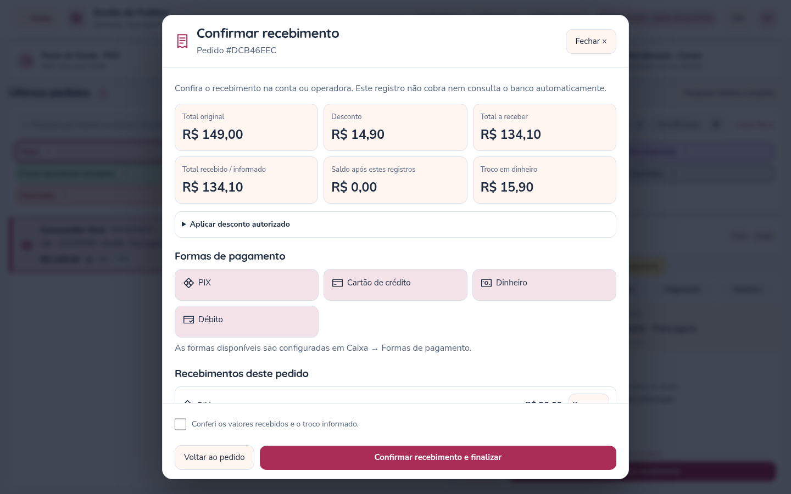
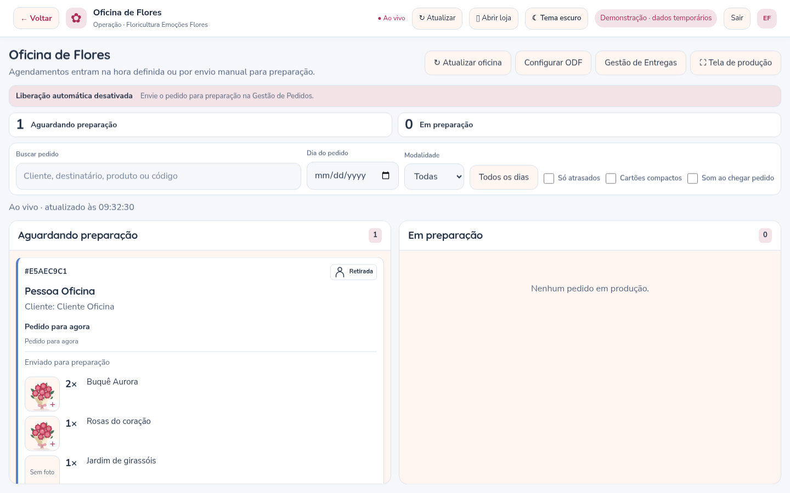
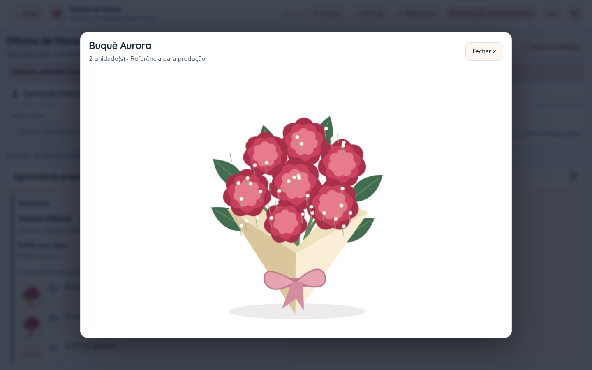

# Recebimentos, pedidos e fotos na Oficina — versão 3.8

## PDV abre a confirmação do recebimento

Depois de **Registrar pedido**, a venda fica salva e a janela **Confirmar recebimento** abre automaticamente. Se fechar a janela, o pedido permanece em Aguardando pagamento. É possível continuar pelo botão Confirmar recebimento na Gestão de Pedidos.

1. Confira os valores na conta, no caixa ou na operadora.
2. Escolha uma forma de pagamento e informe o valor recebido nela.
3. Adicione outras formas, se necessário. Exemplo: parte em Pix e parte em dinheiro.
4. Confira o saldo e o troco, marque a confirmação e finalize.

Um recebimento menor que o total é registrado como **parcial**. O saldo continua pendente, e a produção permanece bloqueada até a quitação. Ao receber o restante, os registros anteriores continuam preservados.



Dinheiro pode ter valor entregue superior ao saldo: o sistema calcula o troco. O Caixa soma somente o valor aplicado ao pedido, excluindo o troco. Pix e cartão não aceitam valor superior ao saldo restante.

As formas disponíveis são individuais por floricultura, em **Gestão → Caixa → Formas de pagamento**. Dinheiro, débito e transferência ficam disponíveis para ativação quando ainda não cadastrados; os meios que a loja já escolheu permanecem com sua configuração. Nomes de meios personalizados representam registros manuais, sem criar automaticamente integrações de cobrança, crediário ou saldo de vale-presente.

## Descontos e histórico

O responsável pela floricultura pode autorizar desconto em reais ou percentual, com motivo obrigatório, **antes do primeiro recebimento**. O desconto é calculado sobre os produtos após eventual cupom; preserva o frete e exige total final maior que zero. Os cálculos usam centavos inteiros, com arredondamento único do percentual.

Cada confirmação registra os valores, a forma de pagamento, a referência opcional, o troco, a data/hora e o usuário autenticado que confirmou. O total anterior e o desconto autorizado também ficam no histórico. A aba **Pagamento** permite consultar os registros; **Histórico** mostra as confirmações.

Antes de confirmar, é possível remover uma linha do rascunho. Recebimentos confirmados não têm botão de apagar ou alterar pela aplicação. Cancelar um pedido com valores recebidos preserva os registros e sinaliza a necessidade de verificar a devolução; não executa estorno bancário nem cria uma devolução fictícia no Caixa.

Após a quitação:

| Modalidade | Resultado |
| --- | --- |
| **Venda Loja** | Concluído, sem passar pela ODF |
| **Retirada / Entrega para agora** | Aguardando preparação |
| **Retirada / Entrega agendada** | Agendado, seguindo a liberação configurada da ODF |

## Caixa e relatórios

O Caixa apresenta cada recebimento na data em que foi confirmado, incluindo valores parciais. Mostra forma de pagamento, referência, responsável e eventual troco. A exportação CSV inclui essas informações. Recebimentos de pedidos cancelados recebem um aviso para conferir a devolução.

O relatório de vendas continua usando os critérios de pedidos pagos e as datas do relatório. O fluxo de caixa usa a data de cada recebimento. Esses totais podem ser diferentes em vendas recebidas em dias distintos. Descontos autorizados entram na análise de descontos, junto dos cupons.

Pagamentos antigos continuam legíveis a partir dos registros existentes; a atualização não inventa parcelas nem identificação de funcionários que não tenham sido gravadas. A consulta financeira mantém o limite de 5.000 pedidos por período e avisa quando atingido. Há limite de 20 recebimentos por confirmação e 200 por pedido.

## Pedidos sem duplicação e concluídos ao fim

O SQL Server pode devolver identificadores com letras maiúsculas, enquanto a criação retorna letras minúsculas. A lista agora usa uma identidade única e mantém a versão mais recente de cada pedido ao combinar respostas do PDV, consultas e eventos ao vivo.

O registro pelo PDV também tem uma chave de envio: se a resposta se perder depois de a venda ser salva, uma nova tentativa recupera a venda existente. No servidor, reenvios iguais não repetem o consumo de estoque ou cupom. As confirmações de recebimento também reconhecem o reenvio da mesma operação e não duplicam as parcelas.

Pedidos em andamento ficam antes dos encerrados. **Concluídos aparecem sempre ao fim**, do mais recentemente concluído ao mais antigo. Para pedidos antigos sem data de conclusão registrada, a ordenação usa a data de criação. Os filtros continuam disponíveis.

## Cabeçalhos e ícones

PDV e demais módulos da floricultura compartilham o cabeçalho, com Voltar, identificação da loja, atualização, acesso ao site, tema e saída. A gestão Inova segue a mesma estrutura visual com as ações próprias da plataforma. O retorno à origem dos atalhos permanece preservado.

Venda Loja usa ícone de loja; Retirada, pessoa; Entrega, caminhão. Pix, dinheiro, cartões e transferências têm ícones acompanhados dos respectivos textos nos pedidos, recebimentos e seletores. O tema claro/escuro funciona também nas janelas novas.

## Fotos na Oficina de Flores

Cada item na ODF mostra a miniatura da imagem cadastrada. Clique ou use o teclado para abrir a imagem ampliada. **Fechar**, **Esc** ou clicar fora da janela retorna ao preparo. Funciona também no modo de tela cheia da oficina. A atualização ao vivo dos cartões preserva a foto ampliada enquanto a equipe a consulta.

Novos pedidos guardam a referência da imagem usada na compra, para que a troca posterior da foto no catálogo não mude a referência de produção. Pedidos anteriores à atualização usam a imagem atual do produto como alternativa, sem reescrever o histórico. Itens sem imagem mostram Sem foto; uma mídia indisponível é sinalizada. A consulta permanece limitada à floricultura autenticada e aceita apenas os caminhos de mídia permitidos para ela.





## Registro interno e proteção dos dados

Confirmar recebimento é uma conferência manual: não cobra cartão, consulta banco ou emite NF-e/NFC-e. As referências não devem conter número de cartão, CVV, senhas ou credenciais. Não há campos para esses dados; a validação rejeita alguns padrões reconhecíveis em referências, mas não substitui o cuidado da equipe ao escrever texto livre.

As rotas exigem autenticação e mantêm o isolamento por floricultura; mutações usam a proteção de sessão/CSRF existente. Descontos exigem perfil responsável no servidor. Os registros de pagamento recebem o usuário da sessão, sem aceitar um nome de autor enviado pelo navegador. Rascunhos ficam em memória e são limpos ao fechar a confirmação ou sair da sessão.

No SQL, recebimentos, total, status e histórico são gravados na mesma transação, com bloqueio da linha e conferência da versão. A restrição de edição do histórico é da aplicação; não torna o banco imutável para um administrador SQL.

Esses controles não são certificação de conformidade com a LGPD. A operação deve definir finalidade, base legal, acesso da equipe, retenção e atendimento aos direitos dos titulares, além de proteger banco, disco e backups, usar HTTPS em produção e manter permissões mínimas. O prazo de retenção deve ser definido considerando as obrigações aplicáveis, sem apagar indiscriminadamente registros financeiros.

## Atualizar no Windows

Para quem já utiliza a versão 3.7, **não há nova migração SQL nem nova variável obrigatória no `.env`**. As informações adicionais usam o JSON existente dos pedidos, e o total descontado também é atualizado na coluna de total. Não recrie o banco. Instalações anteriores devem observar as migrações indicadas nos respectivos guias.

1. Pare o servidor com **Ctrl+C**.
2. Faça seu backup habitual e preserve `.env`, banco, `.tenants`, `.product-media`, `.wwebjs_auth`, `.wwebjs_cache` e os demais dados privados.
3. Atualize os arquivos do código, incluindo `package.json` e `package-lock.json`.
4. No terminal, dentro da pasta que contém `server.js`, execute:

```bat
npm ci
npm run media:setup
npm audit
npm start
```

5. Pressione **Ctrl+F5 em todas as telas abertas**.
6. Confira as formas ativas em Caixa e faça uma venda de teste para verificar o recebimento e os registros. Antes de usar dados reais, valide o fluxo no seu SQL Server e confira o backup.

O pacote também atualiza, por substituições restritas ao conector WhatsApp, `glob` para 14.0.3 e `minimatch` para 11.0.3, corrigindo os avisos moderados encontrados na auditoria final. Mantém o conector na versão 1.34.7 e a correção anterior do Puppeteer. Não é necessário executar `npm audit fix --force`. A auditoria desta entrega informou **zero vulnerabilidades conhecidas**, o que pode mudar com a publicação de novos avisos.

## Validação desta entrega

**141 testes automatizados** aprovados. Incluem recebimentos mistos/parciais, descontos e permissões, troco, reenvios simultâneos, cupom utilizado uma vez, isolamento entre lojas, normalização dos identificadores SQL, ordenação e datas do Caixa. O teste de contrato SQL verifica atualização atômica do total/JSON e reversão em falhas. A compactação ZIP usada pela dependência do WhatsApp foi exercitada com os pacotes corrigidos, incluindo subpastas e exclusões.

No Chromium, foram testados o PDV com perda simulada da resposta de criação, códigos em maiúsculas na consulta, abertura automática do recebimento, Pix + dinheiro, desconto, troco, parcial e quitação, sem linha duplicada. Também foram conferidos os 21 módulos, navegação, envio de mídias, cabeçalhos, miniatura/ampliação na ODF, atualização durante a ampliação, fechamento por Esc/troca de módulo e resoluções de computador, tablet e celular nos dois temas.

A API nativa de tela cheia não pôde ser exercitada no Chromium sem interface deste ambiente; confira essa ação no navegador da loja. As prévias usam dados fictícios em demonstração. O SQL Server do computador da loja, impressoras físicas e contas reais de pagamento/WhatsApp não foram acessados neste ambiente.
