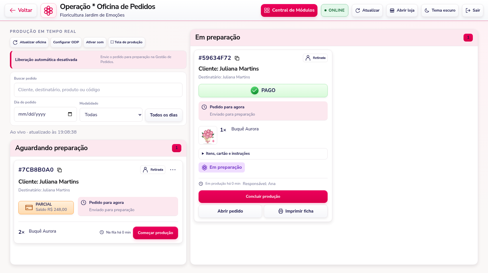
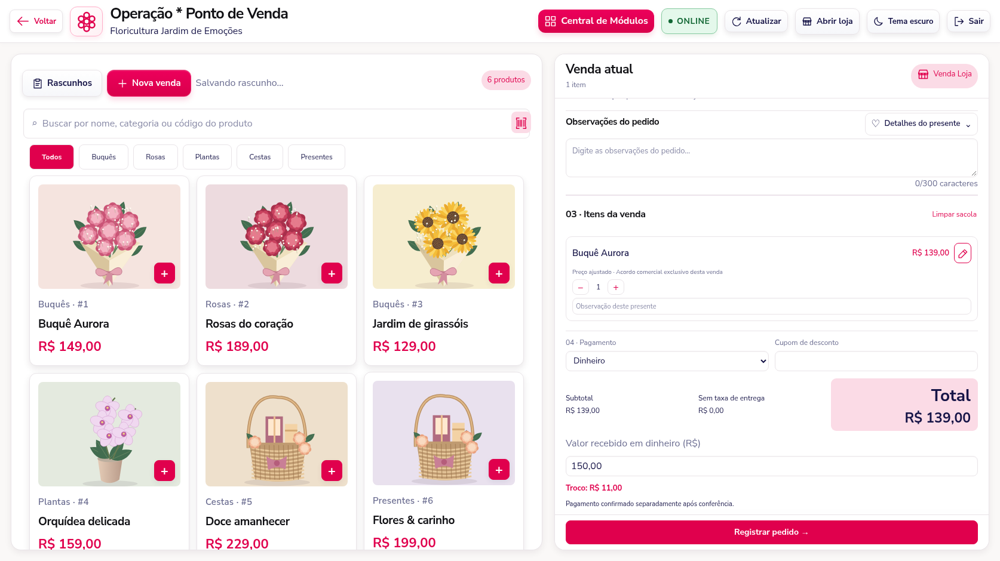
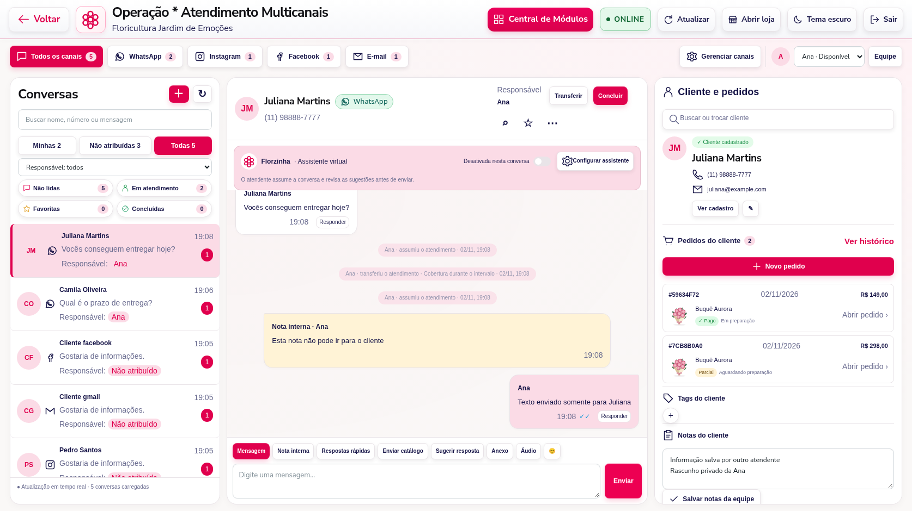

# Revisão das três referências — 3.16.1

A comparação foi feita com as três imagens reenviadas: Oficina de Pedidos, PDV e Atendimento Multicanais. A versão 3.16 já continha os fluxos principais; esta revisão corrige diferenças de apresentação e de uso encontradas na conferência. As capturas abaixo usam dados fictícios e canais simulados.

## Imagem 1 — Oficina de Pedidos

| Item conferido | Resultado |
| --- | --- |
| Controles/fila à esquerda e produção à direita | Mantidos e conferidos no navegador. |
| Código copiável, cliente, destinatário e modalidade | Disponíveis no cartão. |
| Pago/parcial, saldo e período | Preservados; parcial continua liberando preparo, com saldo obrigatório antes da entrega/retirada. |
| Quantidade, tempo de fila e Começar produção | Reorganizados no rodapé compacto, como na referência. |
| Imagem ampliável, instruções, cartão, Concluir produção e checklist | Preservados. |
| Abrir pedido/imprimir ficha de quem aguarda produção | Acessíveis pelo menu de mais ações, mantendo o cartão compacto. |
| Configurar ODP | Agora abre diretamente a configuração da oficina, sem trocar de módulo. |
| Tela de produção | Abre um modo que ocupa a janela e permite sair pelo botão ou Esc; utiliza a tela cheia nativa quando disponível, sem deixar o botão aguardando indefinidamente. |
| Som, atualização e liberação automática | Mantidos. O texto explica recebimentos integrais e parciais. |



## Imagem 2 — PDV

| Item conferido | Resultado |
| --- | --- |
| Catálogo e venda atual em painéis separados | Conferidos; Nova venda recebeu o destaque principal. |
| Busca/categorias/código, rascunhos e quantidade | Preservados. A busca por leitor também atualiza o catálogo após limpar o código. |
| Modalidade, cliente, observações e complementos/fotos | Preservados; contador de observações acompanha também valores restaurados. |
| Editar preço | Abre preço unitário e motivo obrigatório. O ajuste pertence somente àquela venda; o catálogo permanece com seu preço original. |
| Registrar motivo e operador | Mantidos no histórico e protegidos no servidor. Somente o responsável autoriza preço exclusivo. |
| Forma escolhida na próxima tela | PIX, cartão de crédito e dinheiro foram testados no navegador, com a opção já preenchida. |
| Dinheiro e troco | Campo aparece ao selecionar Dinheiro; recebido acima do total mostra troco e valor menor mostra saldo. Digitar o recebido não refaz a cotação no servidor. |
| Confirmação de recebimento | Continua explícita. Escolher a forma ou digitar dinheiro não confirma pagamento sozinho. |



## Imagem 3 — Atendimento Multicanais

| Item conferido | Resultado |
| --- | --- |
| Canais no topo | WhatsApp, Instagram, Facebook e E-mail, agrupando Gmail/Outlook/IMAP. Contagens vêm dos dados carregados. |
| Atendente e disponibilidade | Nome, iniciais e disponibilidade no topo; estado da equipe atualizado periodicamente. |
| Minhas / Não atribuídas / Todas e responsável | Preservados; a lista abre nas não atribuídas quando o usuário ainda não tem conversas. |
| Não lidas / Em atendimento / Favoritas / Concluídas | Agora são atalhos com ícones, contagens e seleção visível. |
| Assumir / Transferir / Concluir / Reabrir | Mantidos. Transferir ganhou formulário próprio, motivo opcional e registro no histórico. Versões antigas são rejeitadas. |
| Assistente | Bloco próprio com nome da loja, ativação na conversa e acesso à configuração. Atua como copiloto: o atendente confere a sugestão antes do envio. |
| Cliente e pedidos | Cadastro, edição, vínculo, imagens dos produtos, valores, pagamento e etapa; dois pedidos recentes ficam no resumo e Ver histórico abre a consulta paginada completa. |
| Tags e notas do cliente | Preservadas. Rascunhos de notas sobrevivem à atualização; conflitos oferecem comparação e texto conciliado antes de salvar. |
| Mensagem / Nota interna | Separadas. Notas internas não são enviadas ao cliente; anexos e áudio ficam no modo Mensagem. |
| Emoji / anexo / áudio / respostas rápidas / catálogo | Preservados e revistos. Emoji agora abre seletor com busca. Áudio tem conferência antes de enviar. |
| Destinatário ao trocar de conversa | Anexo de uma seleção antiga é bloqueado. Gravação é cancelada e o microfone liberado. Permissão de microfone que chega depois da troca também é descartada, mesmo voltando ao contato anterior. |
| Rascunho e envio em andamento | Texto fica separado por conversa; trocar de contato durante o envio mantém o destinatário original e preserva o rascunho da outra conversa. |
| Histórico, busca de mensagens e favoritos | Disponíveis no cabeçalho/menu. Atualizações preservam a leitura sem forçar a rolagem ao fim. |
| Vários atendentes na mesma rede | Operadores autenticados possuem cotas individuais; erros de acesso continuam limitados por IP. Um teste HTTP executa 315 consultas com usuários distintos na mesma rede. |
| Gerenciamento dos canais e chaves | Conexões, credenciais e configuração da assistente são reservadas ao responsável da floricultura. Atendentes usam os canais já conectados. |



O nome, os produtos, as imagens, as quantidades e os avatares seguem os dados do cadastro. Quando não há foto de uma pessoa, aparecem suas iniciais. Os números das imagens de referência não são inseridos como dados fictícios na operação real.

## Atualização e verificações

Esta revisão não acrescenta tabelas às da versão 3.16. Preserve `.env`, banco, sessões, mídias, `.order-uploads` e `.driver-access` ao substituir os arquivos.

```cmd
npm ci
npm start
```

Use **Ctrl + F5** no painel. Se vier da 3.15 ou anterior, instale também o esquema da 3.16, conforme [guia de atualização](OPERACAO-MULTICANAL-E-ENTREGAS-3.16.md), antes de iniciar:

```cmd
npm run migrate:operations-studio
```

Testes de servidor:

```cmd
npm test
```

Verificação opcional destas referências em Chromium:

```cmd
npm run verify:references
```

O teste cria uma floricultura temporária em demonstração, usa canais simulados e não envia mensagens reais. Se necessário, defina `CHROME_PATH` com o executável do Chrome/Chromium instalado. `REVIEW_OUTPUT_DIR` permite escolher o diretório das capturas.

A execução cobre ODP, PIX/cartão/dinheiro, preço/motivo, troco, transferência, notas concorrentes, destinatários de anexos/áudios/textos e quatro larguras nos temas claro/escuro. Canais e IA reais continuam dependendo das credenciais e conexões da instalação. Esta revisão não comprova o funcionamento do SQL Server, do WhatsApp ou das impressoras do servidor do cliente.
