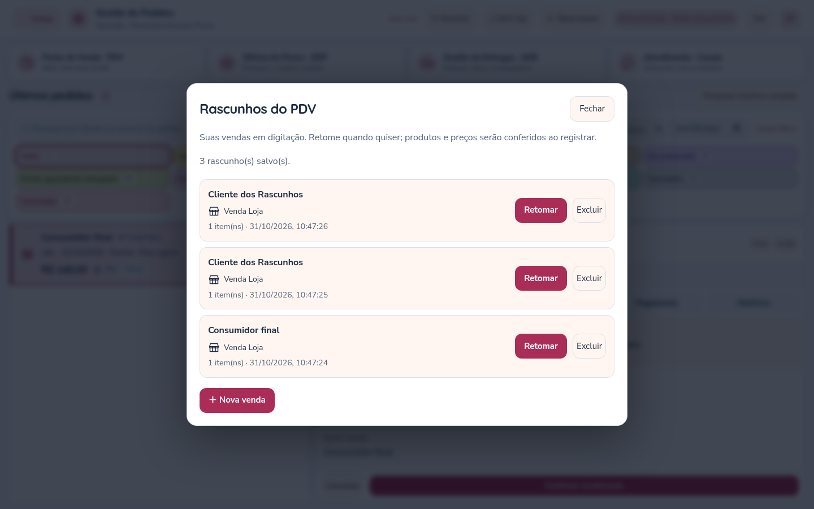
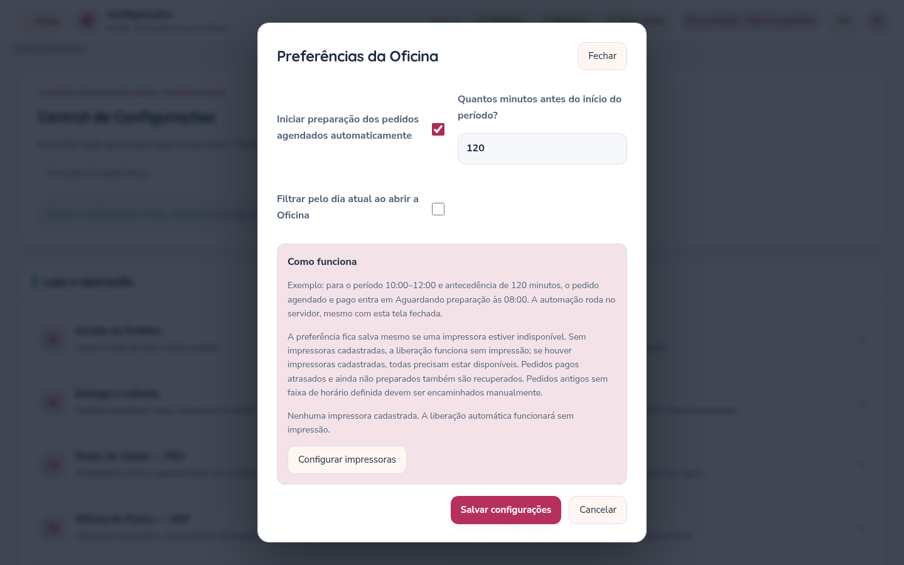
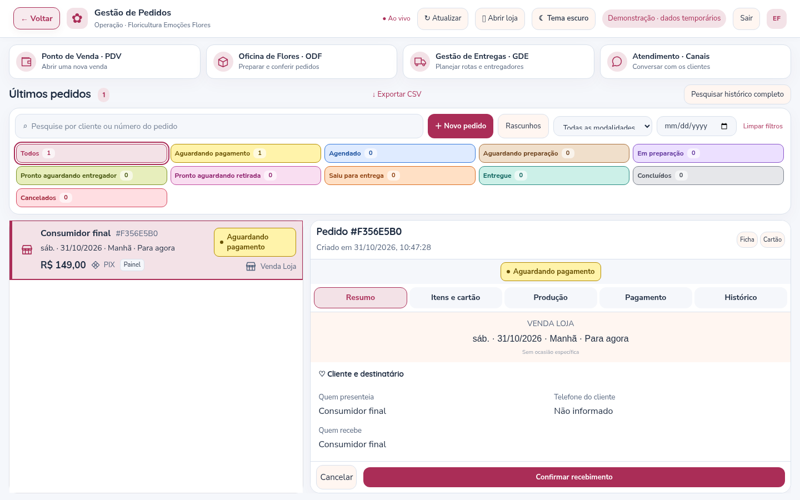

# Prévia da central de pedidos

## Rascunhos e leitura dos pedidos · versão 3.9

Dados fictícios em demonstração. Consulte o [guia de atualização e nova tabela SQL](../RASCUNHOS-E-OFICINA-3.9.md).

## Recebimentos e Oficina · versão 3.8

As imagens usam dados fictícios em demonstração. Leia o [guia da atualização](../RECEBIMENTOS-E-VISUAL-3.8.md).

## Versões anteriores

A imagem `gestao-pedidos.png` foi capturada no Chromium com pedidos fictícios criados somente para validação em modo demonstração. Nenhum desses pedidos integra o banco da floricultura.

## PDV e agendamento

As imagens abaixo mostram a versão 1.2 em demonstração, com catálogo ilustrativo e sem cobrança.

## Busca e cadastro de clientes · versão 1.3

Cadastros e telefones abaixo são fictícios e foram criados apenas para validação em modo demonstração.

## Entrega e histórico de endereços · versão 1.4

Dados fictícios em demonstração. O preenchimento por CEP foi validado com respostas simuladas do ViaCEP; a consulta real precisa ser conferida no computador da loja.

